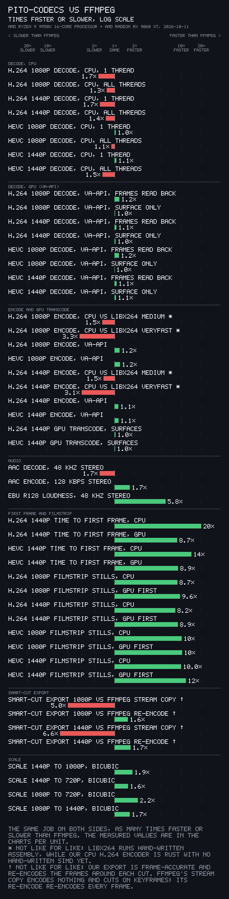
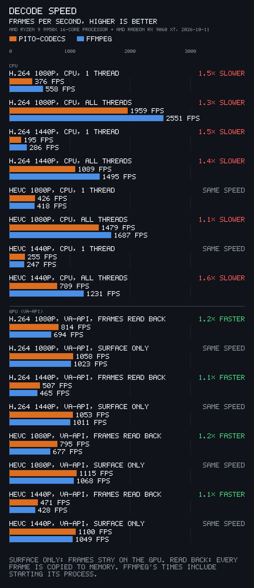
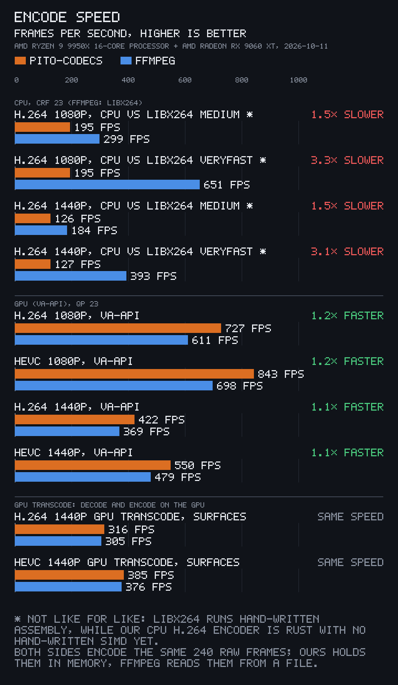
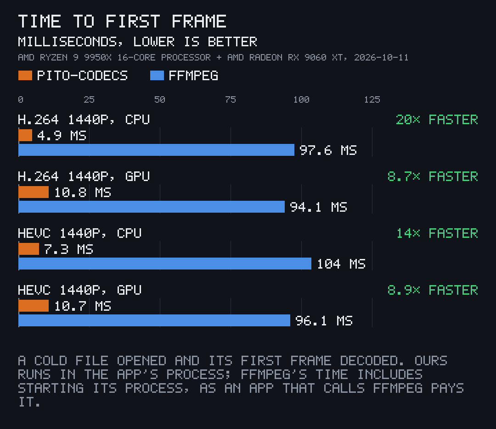
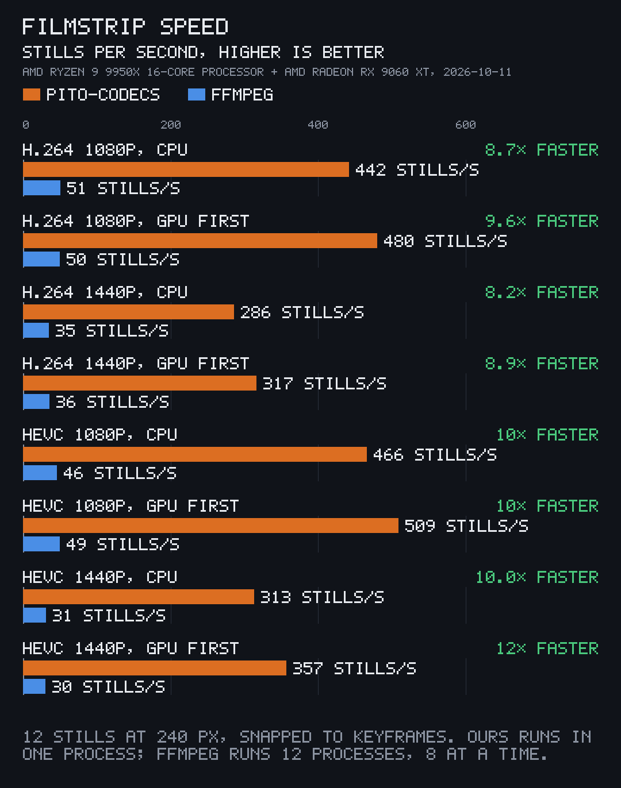
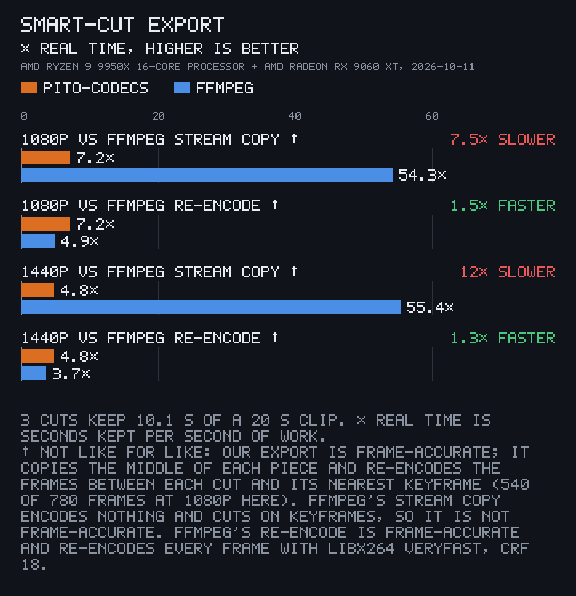
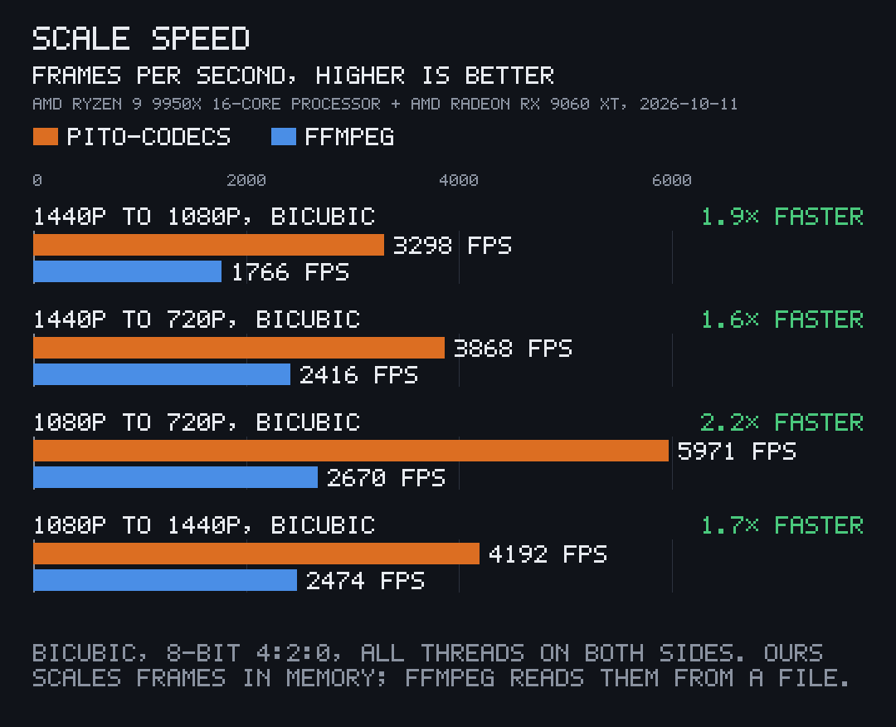
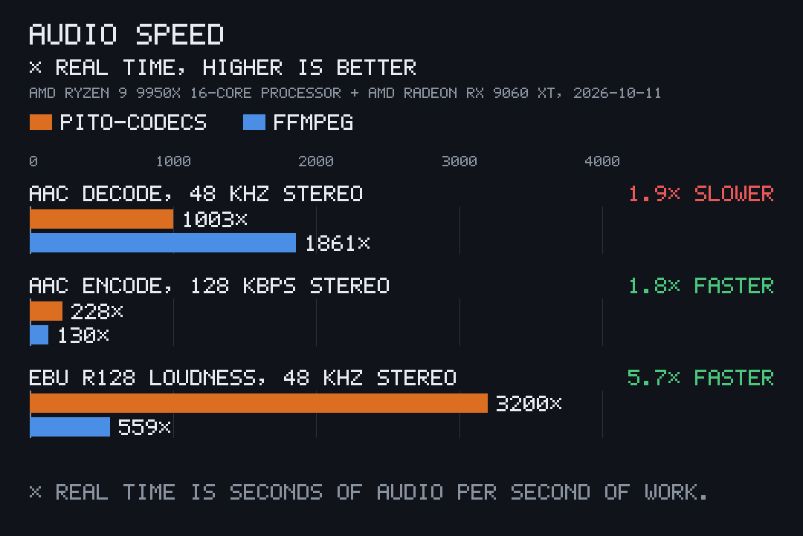

<p align="center"></p>

# pito-codecs

[](https://github.com/gmrdad82/pito-codecs/actions/workflows/ci.yml) [](https://github.com/gmrdad82/pito-codecs/tags)

pito-codecs is a pure Rust library of fast video, audio and image codecs and containers that run on the CPU and on the GPU. It covers H.264, H.265, VP9, AAC, Opus, MP4, MKV and WebM, GIF and WebP. It is part of [PITO](https://pitomd.com) and ships as one MIT Cargo package with a feature per part. It needs no ffmpeg: none is linked or bundled, and ffmpeg serves only as the test oracle and the benchmark reference.

Works on Linux x86-64 and arm64, Windows x86-64 and macOS on Apple Silicon; CI tests every push on all four.

## Status

`v1.0.1`: every format below decodes and encodes, on Linux, Windows and macOS, and the API is settled. Opus speech encoding (SILK and hybrid) is marked experimental below: it decodes clean but doesn't sound as good as libopus.

| Part | Decode | Encode |
| --- | --- | --- |
| H.264 | CPU: Baseline, Main and High, progressive 8-bit 4:2:0, CAVLC and CABAC, bit-exact with ffmpeg. GPU: VA-API and VideoToolbox for the same profiles, bit-exact. | CPU: Baseline, Main and High with CABAC and B-frames; CRF, QP, CBR and VBR. GPU: VA-API High; VideoToolbox Main and High. |
| H.265 | CPU: Main and Main 10, tiles and WPP, bit-exact with ffmpeg. GPU: VA-API and VideoToolbox, Main and Main 10, bit-exact. | GPU only: VA-API Main; VideoToolbox Main and Main 10. Without a GPU HEVC encoder it falls back to H.264 and says why. |
| VP9 | CPU: profiles 0 to 3 (8, 10 and 12-bit; 4:2:0, 4:2:2 and 4:4:4), tiles, bit-exact with ffmpeg and libvpx. GPU: VA-API for 8 and 10-bit 4:2:0, bit-exact. | CPU: profile 0, with motion search, trellis, rate control, AQ and tile threads. ffmpeg and libvpx decode it bit-exact to our reconstruction. |
| AAC | AAC-LC, mono to 7.1. | AAC-LC, CBR and VBR. |
| Opus | SILK, CELT, hybrid and multistream; the RFC 8251 conformance vectors decode to the reference's final range on every packet. | CELT, VBR and CBR, 6 to 510 kbps, decoded clean by libopus. **Experimental:** SILK and hybrid for speech decode clean in libopus but sound worse than libopus at low rates. |
| MP4 and MOV | Tracks, sample tables, rotation, edit lists, fragmented files. | MP4 or MOV, faststart or fragmented; remux of a time range without re-encoding. |
| MKV and WebM | Tracks, lacing, Cues, seeking. | H.264, HEVC, VP9, Opus and AAC; WebM's codec rules enforced; remux. |
| GIF | GIF87a and 89a, interlace, disposal, transparency, loops. | Oklab palettes, ordered or Floyd-Steinberg dither, frame differencing. |
| WebP | Lossless VP8L and lossy VP8, alpha, animation; bit-exact with libwebp. | Lossless VP8L and lossy VP8, alpha, animation. |
| Filters | | Scale (bilinear, bicubic, Lanczos), BT.601/709/2020 colour, rotate, flip, crop, pad, fps change, RGBA overlay, resample, downmix, gain, EBU R128 loudness, true-peak limiter, normalise. |

The GPU route is tested on Linux with VA-API, on an AMD Radeon RX 9060 XT with Mesa's radeonsi driver, and on macOS with VideoToolbox on GitHub's Apple Silicon runners, where CI checks its decode bit-exact with ffmpeg and decodes its encodes back on every push. NVENC (Linux and Windows) and Media Foundation (Windows) compile for their targets and pass their unit tests, but CI's runners have no GPU, so they are untested on their hardware.

## Against ffmpeg

Every number here comes from the one benchmark run that the Speed section describes, and the charts and the table there show the same results.

Where pito-codecs is faster:

- **Time to first frame:** 7.4× to 21.5× faster at 1440p, CPU or GPU (4.1 ms against 87.4 ms for H.264 on the CPU; ffmpeg's time includes starting its process).
- **Filmstrip stills:** 7.6× to 12.4× faster.
- **Smart-cut export against a full re-encode:** 1.7× to 2.9× faster, frame-accurate on both sides.
- **GPU decode and encode (VA-API):** 1.1× to 1.3× faster on 8 of the 14 GPU rows, about the same on 6.
- **Scaling:** 1.7× to 2.6× faster.
- **Loudness (EBU R128):** 5.7× faster.
- **AAC encode:** 1.8× faster.

Where ffmpeg wins:

- **CPU H.264 decode:** ffmpeg is 1.3× to 1.5× faster (2551 against 1959 fps at 1080p, all threads).
- **CPU HEVC decode:** about the same on one thread; on all threads ours is 1.1× slower at 1080p and 1.6× slower at 1440p.
- **CPU H.264 encode against x264:** libx264 is 1.5× to 3.4× faster (medium and veryfast presets).
- **AAC decode:** ffmpeg is 1.9× faster.
- **Smart-cut export against a stream copy:** ffmpeg's copy is 5.8× to 6.0× faster, but it encodes nothing and cuts only on keyframes, so it isn't frame-accurate.
- **Not in this run:** VP9 encode speed and Opus speech (SILK and hybrid) encode quality aren't benchmarked here; Opus speech encode is marked experimental.

## What it is

**Formats.** GPU means VA-API, VideoToolbox, NVENC or Media Foundation, as the Status section says; NVENC and Media Foundation are built and pass their unit tests but are untested on their hardware. For containers and images, decode is reading and encode is writing.

| Format | Decode CPU | Decode GPU | Encode CPU | Encode GPU |
| --- | --- | --- | --- | --- |
| H.264 | Yes | VA-API, VideoToolbox, Media Foundation | Yes | VA-API, VideoToolbox, NVENC |
| H.265 | Yes | VA-API, VideoToolbox, Media Foundation | No | VA-API, VideoToolbox, NVENC |
| VP9 | Yes | VA-API | Yes (profile 0) | No |
| AAC | Yes (AAC-LC) | — | Yes (AAC-LC) | — |
| Opus | Yes | — | Yes (CELT; SILK and hybrid experimental) | — |
| PCM (s16, s24, s32, f32, f64) | Yes | — | No | — |
| MP4 and MOV | Yes | — | Yes | — |
| MKV and WebM | Yes | — | Yes | — |
| GIF | Yes | — | Yes | — |
| WebP | Yes | — | Yes | — |

Not covered: AC3 and E-AC3, DTS, MP3, FLAC, Vorbis, ALAC, AV1, ProRes, DNxHD, MPEG-2 and VP8 video, and subtitle tracks.

- **Speed first.** Decoders are threaded across rows and frames, SIMD kernels are picked at run time, and buffers are pooled. GPU frames stay on the GPU from decode to encode.
- **Video:** H.264 and H.265 decode and encode on the CPU and the GPU (H.265 encodes on the GPU only), VP9 decode on the CPU and through VA-API, and VP9 encode on the CPU.
- **Audio:** AAC-LC and Opus decode and encode, and PCM decode from MP4, MOV, MKV and WebM.
- **Containers:** MP4, MOV, MKV and WebM read, write and remux; Ogg Opus.
- **Images:** GIF and WebP, still and animated.
- **Filters** between decode and encode (`filter`): scaling, colour, geometry, frame rate, overlays, resampling and loudness.
- **A front for apps** (`media`), which picks the fastest working route for each call. It can probe a file, give the first frame or stills for a filmstrip, play a file, pull its audio as PCM over any time range or as a stereo mix of its tracks with a gain each, and export with smart cuts, which copy the middle of each piece and re-encode only the edges.

## Install

### pcod, the command line

Each [GitHub Release](https://github.com/gmrdad82/pito-codecs/releases/latest) carries pcod for Linux x86-64, Windows x86-64 and macOS on Apple Silicon. Each archive holds the binary, `LICENSE`, `README.md` and `NOTICE`, and `SHA256SUMS` lists every archive's checksum. Set `v` to the latest release's tag, then download, unpack and put pcod on your `PATH`.

Linux x86-64:

```sh
v=vX.Y.Z; curl -fsSLO "https://github.com/gmrdad82/pito-codecs/releases/download/$v/pcod-$v-linux-x86_64.tar.gz"
tar -xzf "pcod-$v-linux-x86_64.tar.gz" pcod && install -Dm755 pcod ~/.local/bin/pcod
```

macOS on Apple Silicon:

```sh
v=vX.Y.Z; curl -fsSLO "https://github.com/gmrdad82/pito-codecs/releases/download/$v/pcod-$v-macos-arm64.tar.gz"
tar -xzf "pcod-$v-macos-arm64.tar.gz" pcod && sudo install -m755 pcod /usr/local/bin/pcod
```

Windows x86-64, in PowerShell:

```powershell
$v="vX.Y.Z"; Invoke-WebRequest "https://github.com/gmrdad82/pito-codecs/releases/download/$v/pcod-$v-windows-x86_64.zip" -OutFile pcod.zip
Expand-Archive pcod.zip "$env:LOCALAPPDATA\pcod" -Force; [Environment]::SetEnvironmentVariable("Path", [Environment]::GetEnvironmentVariable("Path", "User") + ";$env:LOCALAPPDATA\pcod", "User")
```

Or build it from source on any of them, Linux arm64 included, with Rust 1.97 or newer:

```sh
cargo install --locked --git https://github.com/gmrdad82/pito-codecs --tag vX.Y.Z pito-codecs --bin pcod
```

What each system needs at run time:

- **Linux:** libva and a VA-API driver (Mesa's or Intel's) for the GPU route. libva is loaded at run time, so pcod starts without it and decodes and encodes on the CPU.
- **macOS:** VideoToolbox, which is part of macOS. Nothing to install.
- **Windows:** Media Foundation, which is part of Windows. Nothing to install. H.265 decode through Media Foundation needs Microsoft's HEVC Video Extensions, and Windows N editions need the Media Feature Pack; without them pcod decodes on the CPU.

### The library

Add it as a git dependency at a tag, with the features you need (all are on by default):

```toml
[dependencies]
pito-codecs = { git = "https://github.com/gmrdad82/pito-codecs", tag = "v1.0.1", default-features = false, features = ["h264", "mp4"] }
```

| Feature | What it holds |
| --- | --- |
| `media` | The shared types (`Codec`, `Frame`, `Packet`, `AudioBuffer`, `Error`) and the front for apps. |
| `h264` | H.264 decode and encode on the CPU. |
| `hevc` | H.265 decode on the CPU, and hvcC parsing. |
| `vp9` | VP9 decode and encode on the CPU. |
| `aac` | AAC-LC decode and encode. |
| `opus` | Opus decode and encode, Ogg Opus. |
| `mp4` | MP4 and MOV read, write and remux. |
| `mkv` | Matroska and WebM read, write and remux. |
| `gif` | GIF decode and encode. |
| `webp` | WebP decode and encode. |
| `gpu` | The GPU routes: VA-API on Linux (libva is loaded at run time, so a binary still starts without it); NVENC, VideoToolbox and Media Foundation behind `cfg(target_os)`. |
| `filter` | Scale, colour, geometry, fps, overlay, resample, loudness. |
| `cli` | The `pcod` binary and its clap dependency; leave it out with `default-features = false`. |

Rust 1.97 or newer, edition 2024.

## Use

Decode an MP4's H.264 track on the CPU:

```rust
use pito_codecs::{h264, mp4};

let file = mp4::Reader::open("clip.mp4")?;
let video = file.video().expect("a video track");
let track = &file.tracks[video];
let mut decoder = h264::Decoder::with_extradata(&track.extradata().unwrap_or_default())?;
for index in 0..track.samples.len() {
    for frame in decoder.decode(&file.packet(video, index)?)? {
        println!("{} {}x{}", frame.pts, frame.width, frame.height);
    }
}
let rest = decoder.flush()?;
```

Encode frames to H.264 at CRF 18:

```rust
use pito_codecs::h264::{Encoder, EncoderConfig, Rate};

let mut encoder = Encoder::new(EncoderConfig { width: 1920, height: 1080, fps: (60, 1), rate: Rate::Crf(18), ..Default::default() })?;
let avcc = encoder.avcc();
let packets = encoder.encode(&frame)?;
```

Decode on the GPU when one is there:

```rust
use pito_codecs::gpu::{self, HwDecoder};
use pito_codecs::media::Codec;

println!("{:?}", gpu::available());
let mut decoder = HwDecoder::new(Codec::Hevc, &hvcc)?;
let frames = decoder.decode(&packet)?;
```

Or let the front pick the route:

```rust
use pito_codecs::media::{Prefs, first_frame, probe};

let prefs = Prefs::default();
let info = probe("clip.mp4".as_ref(), &prefs)?;
let still = first_frame("clip.mp4".as_ref(), 240, &prefs)?;
```

Export an edit with audio you mixed yourself: the callback gets each piece's index and its exact sample count and returns that many 48 kHz stereo samples, which our AAC encoder turns into one track as long as the video to the sample:

```rust
let done = export_with_audio("edit.mp4".as_ref(), &pieces, ExportOptions::default(), |piece, samples| mixer.render(piece, samples), |_| true)?;
```

`pcod` (`src/bin/pcod.rs`) is a small command line over the library, and it is what the GIF above shows: `pcod decode clip.mp4 --route gpu`, or from a checkout `cargo run --release --bin pcod -- decode clip.mp4 --route gpu`. It is behind the `cli` feature, on by default, so a library user with `default-features = false` never builds clap.

## Routes

The front tries the GPU first and our own CPU code second, for every decode and every encode.

- **GPU first.** VA-API on Linux decodes and encodes H.264 and H.265.
- **Then the CPU.** When there is no GPU route (no VA-API device or driver, or no GPU decoder or encoder for that codec), our CPU code takes the job.
- **H.265 encodes on the GPU only.** Without a GPU HEVC encoder it falls back to H.264 on the GPU, then to H.264 on the CPU.
- **An export whose GPU encoder refuses to start** (a size or format the hardware won't take) encodes H.264 on the CPU instead.
- **Every fallback says why**, in a plain reason the app can show, such as "no GPU HEVC encoder on this machine; encoding H.264 on the GPU instead".

## Speed

Each pair below was measured back to back against the system ffmpeg on the same file, in one run on 2026-10-11 at commit `415391d`:

- **CPU:** AMD Ryzen 9 9950X (16 cores).
- **GPU:** AMD Radeon RX 9060 XT on Mesa 26.2 radeonsi through VA-API, on Linux.
- **ffmpeg:** 9.0.1.

The input is 20 s of NASA's public-domain "A Message of Resilience from the International Space Station" (720p60), scaled to 1080p and 1440p and encoded with libx264 at CRF 20 and libx265 at CRF 23; the audio is NASA's public-domain solstice interview. The command is `pgpu run -- cargo run --release --example bench -- --runs 1`, which writes `tmp/bench/results.json` and every chart below; `--charts-only` redraws the charts from that file. The machine was shared with other work (load average 4.5 at the start, up to 18 during the run), so the absolute numbers are floors; 17 rows that another GPU job disturbed (H.264 1080p VA-API encode, the filmstrips, the smart-cut exports and the scales) were measured again right after with `--only` into the same results file.



The chart above shows each job as times faster or slower than ffmpeg, on a log scale centred on the same speed, so 2× slower is as long as 2× faster. The charts below hold the measured values, one chart per unit, pito-codecs and ffmpeg side by side on one axis from zero. Rows marked * or † are not like for like, and each chart says why under it.









| Job | pito-codecs | ffmpeg | pito-codecs is |
| --- | --- | --- | --- |
| H.264 1080p decode, CPU, 1 thread | 376 fps | 558 fps | 1.5× slower |
| H.264 1080p decode, CPU, all threads | 1959 fps | 2551 fps | 1.3× slower |
| HEVC 1080p decode, CPU, 1 thread | 426 fps | 418 fps | about the same |
| HEVC 1080p decode, CPU, all threads | 1479 fps | 1687 fps | 1.1× slower |
| H.264 1440p decode, CPU, 1 thread | 195 fps | 286 fps | 1.5× slower |
| H.264 1440p decode, CPU, all threads | 1089 fps | 1495 fps | 1.4× slower |
| HEVC 1440p decode, CPU, 1 thread | 255 fps | 247 fps | about the same |
| HEVC 1440p decode, CPU, all threads | 789 fps | 1231 fps | 1.6× slower |
| H.264 1080p decode, VA-API, frames stay on the GPU | 1058 fps | 1023 fps | about the same |
| H.264 1080p decode, VA-API, frames read back | 814 fps | 694 fps | 1.2× faster |
| HEVC 1080p decode, VA-API, frames stay on the GPU | 1115 fps | 1068 fps | about the same |
| HEVC 1080p decode, VA-API, frames read back | 795 fps | 677 fps | 1.2× faster |
| H.264 1440p decode, VA-API, frames stay on the GPU | 1053 fps | 1011 fps | about the same |
| H.264 1440p decode, VA-API, frames read back | 507 fps | 465 fps | 1.1× faster |
| HEVC 1440p decode, VA-API, frames stay on the GPU | 1100 fps | 1049 fps | about the same |
| HEVC 1440p decode, VA-API, frames read back | 471 fps | 428 fps | 1.1× faster |
| H.264 1080p encode, CPU, CRF 23, against libx264 medium * | 191 fps | 328 fps | 1.7× slower |
| H.264 1080p encode, CPU, CRF 23, against libx264 veryfast * | 184 fps | 626 fps | 3.4× slower |
| H.264 1080p encode, VA-API, QP 23 | 645 fps | 499 fps | 1.3× faster |
| HEVC 1080p encode, VA-API, QP 23 | 839 fps | 686 fps | 1.2× faster |
| H.264 1440p encode, CPU, CRF 23, against libx264 medium * | 121 fps | 181 fps | 1.5× slower |
| H.264 1440p encode, CPU, CRF 23, against libx264 veryfast * | 121 fps | 396 fps | 3.3× slower |
| H.264 1440p encode, VA-API, QP 23 | 412 fps | 371 fps | 1.1× faster |
| HEVC 1440p encode, VA-API, QP 23 | 545 fps | 476 fps | 1.1× faster |
| H.264 1440p GPU transcode, frames stay on the GPU | 309 fps | 300 fps | about the same |
| HEVC 1440p GPU transcode, frames stay on the GPU | 379 fps | 371 fps | about the same |
| H.264 1440p time to first frame, CPU (ffmpeg includes starting its process) | 4.1 ms | 87.4 ms | 21.5× faster |
| H.264 1440p time to first frame, GPU (ffmpeg includes starting its process) | 11.6 ms | 85.7 ms | 7.4× faster |
| HEVC 1440p time to first frame, CPU (ffmpeg includes starting its process) | 8.1 ms | 106.3 ms | 13.1× faster |
| HEVC 1440p time to first frame, GPU (ffmpeg includes starting its process) | 12.4 ms | 100.7 ms | 8.1× faster |
| H.264 1080p filmstrip, 12 stills at 240 px, CPU | 414 stills/s | 46 stills/s | 8.9× faster |
| H.264 1080p filmstrip, 12 stills at 240 px, GPU first | 407 stills/s | 47 stills/s | 8.7× faster |
| H.264 1440p filmstrip, 12 stills at 240 px, CPU | 268 stills/s | 29 stills/s | 9.4× faster |
| H.264 1440p filmstrip, 12 stills at 240 px, GPU first | 263 stills/s | 33 stills/s | 8.0× faster |
| HEVC 1080p filmstrip, 12 stills at 240 px, CPU | 364 stills/s | 44 stills/s | 8.2× faster |
| HEVC 1080p filmstrip, 12 stills at 240 px, GPU first | 359 stills/s | 32 stills/s | 11.4× faster |
| HEVC 1440p filmstrip, 12 stills at 240 px, CPU | 257 stills/s | 21 stills/s | 12.4× faster |
| HEVC 1440p filmstrip, 12 stills at 240 px, GPU first | 167 stills/s | 22 stills/s | 7.6× faster |
| Smart-cut export 1080p, 3 cuts, against ffmpeg re-encoding every frame (both frame-accurate) † | 11.9× real time | 7.2× real time | 1.7× faster |
| Smart-cut export 1080p, 3 cuts, against ffmpeg's stream copy (keyframe cuts only, not frame-accurate) † | 11.9× real time | 69.4× real time | 5.8× slower |
| Smart-cut export 1440p, 3 cuts, against ffmpeg re-encoding every frame (both frame-accurate) † | 8.7× real time | 3.0× real time | 2.9× faster |
| Smart-cut export 1440p, 3 cuts, against ffmpeg's stream copy (keyframe cuts only, not frame-accurate) † | 8.7× real time | 52.7× real time | 6.0× slower |
| Scale 1440p to 1080p, bicubic | 2934 fps | 1430 fps | 2.1× faster |
| Scale 1440p to 720p, bicubic | 2537 fps | 1221 fps | 2.1× faster |
| Scale 1080p to 720p, bicubic | 4351 fps | 1695 fps | 2.6× faster |
| Scale 1080p to 1440p, bicubic | 3459 fps | 2093 fps | 1.7× faster |
| AAC decode, 48 kHz stereo | 1003× real time | 1861× real time | 1.9× slower |
| AAC encode, 128 kbps stereo | 228× real time | 130× real time | 1.8× faster |
| EBU R128 loudness, 48 kHz stereo | 3200× real time | 559× real time | 5.7× faster |

\* libx264 is hand-written assembly; our CPU H.264 encoder has no hand-written SIMD. † Our export copies the middle of each piece and re-encodes only around each cut, so it is frame-accurate; a stream copy encodes nothing and cuts only on keyframes.

## Build and test

```
cargo build --release
cargo test --release
```

The tests use the system ffmpeg as an oracle when it is installed and skip those checks when it is not, and the GPU tests skip cleanly without a device. `bin/gate` runs rustfmt, clippy with warnings as errors and the tests, then a release build (`--fast` skips the build).

[CI](.github/workflows/ci.yml) runs on every push and pull request. One job checks formatting and runs clippy for Linux x64 and arm64, Windows and macOS. Then four runners test in parallel: Linux x64 and Linux arm64 (Debian with its ffmpeg), Windows x64 and macOS on Apple Silicon, each with every test under nextest in the `ci` profile (the release optimisation without LTO, so the test binaries link quickly), the doc tests and a full release build. On a `v` tag it also checks that the tag matches the crate's version. What that covers:

- **CPU codecs, containers and filters** on x86-64 with the AVX2 kernels, and on arm64 with the portable paths and the filters' NEON kernels, on Linux, Windows and macOS.
- **VideoToolbox** on macOS: H.264 and H.265 decode bit-exact with ffmpeg, H.264 and H.265 encode decoded back by ffmpeg, bitrate modes, and a transcode that scales on the GPU.
- **Media Foundation and NVENC** only build and run their unit tests, since the runners have no GPU.
- **VA-API** runs on the maintainer's AMD machine before each release, with the benchmarks.

## Contributing

Issues are welcome at [github.com/gmrdad82/pito-codecs/issues](https://github.com/gmrdad82/pito-codecs/issues). Useful ones include a file that decodes wrong or slowly (with a small sample, where you can share one), a route that falls back when it shouldn't, or a format you need. Pull requests aren't taken. Please read the [code of conduct](CODE_OF_CONDUCT.md) first, and report security issues privately, as [SECURITY.md](SECURITY.md) describes.

## Credits

Parts are adapted from [FilmCraft](https://github.com/storytold/filmcraft) (MIT OR Apache-2.0, taken under MIT) and from libwebp (BSD-3-Clause). The VA-API and NVENC declarations follow the MIT-licensed libva and NVIDIA headers. Permissive projects such as libvpx and libopus (BSD-3-Clause) may be ported with their notices; the GPL and LGPL ones (FFmpeg, x264, x265, libde265) are never copied, and ffmpeg serves only as the test oracle and the benchmark reference. The ITU-T H.264 and H.265 Recommendations, the VP9 specification, RFC 6716, RFC 6386, the GIF89a specification and the ISO MP4 and AAC standards are the sources. Origins are listed in [INSPIRATION.md](INSPIRATION.md) and their notices in [NOTICE](NOTICE). The demo and benchmark clips are public-domain NASA footage from PITO's fixture sets.

## Licence

The code is MIT licensed ([LICENSE](LICENSE)), © Catalin Ilinca. The PITO name and its logos are © Catalin Ilinca, all rights reserved, and are not covered by the MIT licence ([TRADEMARKS.md](TRADEMARKS.md)).
