<p align="center">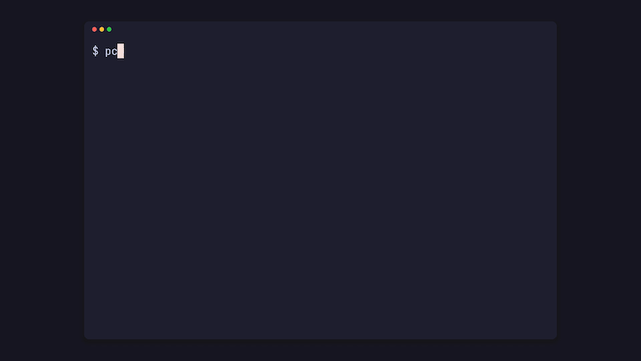</p>

# pito-codecs

[](https://github.com/gmrdad82/pito-codecs/tags)

**Video and audio codecs in pure Rust, on the CPU and the GPU, with no ffmpeg inside.** H.264, H.265, VP9, AV1 decode, AAC, AC-3, E-AC-3, Opus, MP3, FLAC and ALAC; MP4, MOV, MKV and WebM; GIF and WebP. One MIT Cargo package, a feature per part, two direct dependencies and no C linked.

- **First frame 12× to 28× faster than ffmpeg:** 4.2 ms against 85.2 ms for a 1440p H.264 file on the CPU.
- **AV1 on the card and the processor:** first frame 1.6× to 4.4× faster than ffmpeg with dav1d, every frame bit-exact with dav1d.
- **Filmstrips 9× to 11× faster:** 12 stills at 240 px in 24 to 36 ms.
- **Frame-accurate smart cuts 1.7× to 2.0× faster** than an ffmpeg re-encode: only the frames around each cut are encoded, and 40 short cuts run 1.3× to 1.4× faster on the card than in 1.4.2.
- **GPU decode and encode on VA-API 1.1× to 1.2× faster** than ffmpeg's, and frames can stay on the card from decode to encode.
- **Overlays composed on the card:** a marked or captioned export uses 18× to 23× less CPU time than decoding and blending on the CPU.
- **Small:** a 5.7 MB command line, and a library that pulls in 8 crates on Linux.

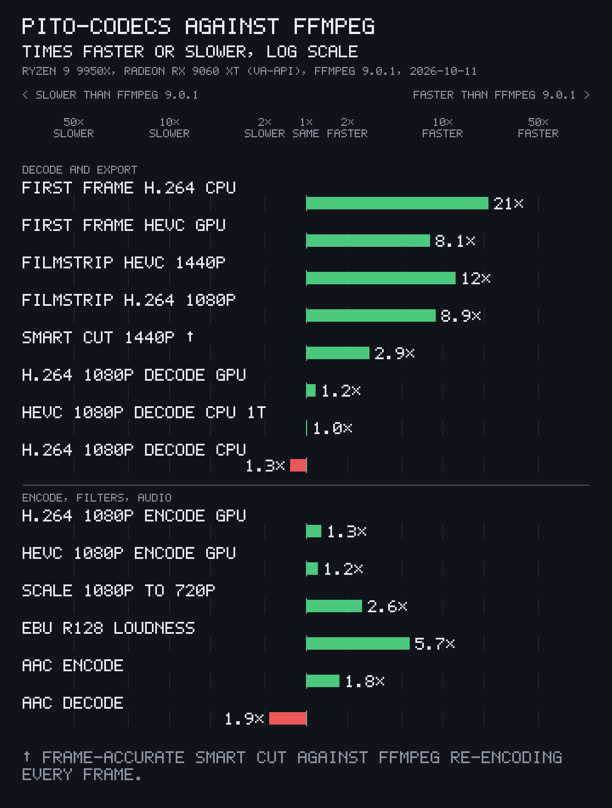

Every speed number on this page was measured on one machine (AMD Ryzen 9 9950X, AMD Radeon RX 9060 XT on Mesa's radeonsi VA-API driver, Linux, ffmpeg 9.0.1) on public-domain NASA footage. [How it was measured](#how-it-was-measured) gives the input, the commands and the load for each.

Got questions or doubts? Ping me on Discord: https://discord.gg/XsNcn3kYzn

## Install and first use

pcod, the command line over the library, comes with every [GitHub Release](https://github.com/gmrdad82/pito-codecs/releases/latest) for Linux x86-64, Windows x86-64 and macOS on Apple Silicon. These lines fetch the latest release.

Linux x86-64:

```sh
v=$(curl -fsSLI -o /dev/null -w '%{url_effective}' https://github.com/gmrdad82/pito-codecs/releases/latest); v=${v##*/}
curl -fsSLO "https://github.com/gmrdad82/pito-codecs/releases/download/$v/pcod-$v-linux-x86_64.tar.gz"
tar -xzf "pcod-$v-linux-x86_64.tar.gz" pcod && install -Dm755 pcod ~/.local/bin/pcod
```

macOS on Apple Silicon:

```sh
v=$(curl -fsSLI -o /dev/null -w '%{url_effective}' https://github.com/gmrdad82/pito-codecs/releases/latest); v=${v##*/}
curl -fsSLO "https://github.com/gmrdad82/pito-codecs/releases/download/$v/pcod-$v-macos-arm64.tar.gz"
tar -xzf "pcod-$v-macos-arm64.tar.gz" pcod && sudo install -m755 pcod /usr/local/bin/pcod
```

Windows x86-64, in PowerShell:

```powershell
$v = (Invoke-RestMethod https://api.github.com/repos/gmrdad82/pito-codecs/releases/latest).tag_name
Invoke-WebRequest "https://github.com/gmrdad82/pito-codecs/releases/download/$v/pcod-$v-windows-x86_64.zip" -OutFile pcod.zip
Expand-Archive pcod.zip "$env:LOCALAPPDATA\pcod" -Force; [Environment]::SetEnvironmentVariable("Path", [Environment]::GetEnvironmentVariable("Path", "User") + ";$env:LOCALAPPDATA\pcod", "User")
```

Then, on any MP4, or on a folder of PNG frames:

```sh
pcod clip.mov web.mp4 --profile best
pcod probe clip.mp4
pcod decode clip.mp4 --route gpu
pcod encode clip.mp4 out.mp4 --codec hevc --route gpu
pcod frames frames/ trailer.mp4 --fps 60 --audio trailer.wav
pcod stills clip.mp4 --count 24 --cols 6 --sheet sheet.png --out stills/
pcod stills clip.mp4 --every 2s --out frames/
pcod filmstrip clip.mp4 strip.png --every 10s --timecodes
```

`SHA256SUMS` in each Release lists every archive's checksum. To build pcod from source anywhere, Linux arm64 included, with Rust 1.97 or newer: `cargo install --locked --git https://github.com/gmrdad82/pito-codecs --tag v2.0.0 pito-codecs --bin pcod`.

In a Rust project, add the library with the parts you need (all are on by default):

```toml
[dependencies]
pito-codecs = { git = "https://github.com/gmrdad82/pito-codecs", tag = "v2.0.0", default-features = false, features = ["h264", "hevc", "vp9", "aac", "mp4", "mkv", "gpu", "filter", "opus", "ac3", "mp3", "flac", "alac"] }
```

and let it pick the fastest route for each job:

```rust
use pito_codecs::media::{Prefs, first_frame, probe};

let prefs = Prefs::default();
let info = probe("clip.mp4".as_ref(), &prefs)?;
let still = first_frame("clip.mp4".as_ref(), 240, &prefs)?;
println!("{}x{} at {}/{} fps, first frame {}x{}", info.width, info.height, info.fps.0, info.fps.1, still.width, still.height);
```

For audio alone, `features = ["audio", "opus", "ac3", "mp3"]` builds the probe (FLAC and ALAC come with `audio`), `audio_pcm_range` and `audio_stream` with no video decoder, GPU code or filters.

The GPU route needs nothing extra: libva is loaded at run time on Linux (Mesa's or Intel's driver), VideoToolbox is part of macOS and Media Foundation part of Windows. Without them everything decodes and encodes on the CPU. On Windows, H.265 decode through Media Foundation needs Microsoft's HEVC Video Extensions, and N editions need the Media Feature Pack.

## Features

### Convert, the command line over everything

`pcod <input> <output>` converts a video, an animated GIF, or a folder of PNG frames, into whatever the output's extension names, and needs no ffmpeg: `mp4`, `mov` and `mkv` get H.264 and AAC, `webm` gets VP9 and Opus (with alpha when the source has it), `gif` and `webp` loop forever, and `wav` takes the audio alone, decoded to 16-bit PCM, with `--mono`, `--rate` and `--loudness`; `opus` (or `ogg`) takes it as Ogg Opus at 48 kHz, 64 kbps stereo or 32 kbps with `--mono` unless `--audio-bitrate` (16 to 510) says otherwise. `pcod spectrum <input> <out.png>` draws an audio track's spectrogram, 1200x360 by default (`--width`, `--height`), log magnitude from 0 dB down to `--floor-db` (-90), linear frequency up to `--max-hz` (12000), with time, frequency and dB axes, and refuses an existing PNG unless `--force`; `--json` gives its size, length and timings. Ogg Opus files read back as input everywhere pcod takes audio; other Ogg streams (Vorbis, FLAC) are refused by name. `--from` and `--to` cut a window of any input, frame-exact, video and audio in sync: with no video option the whole GOPs inside it are copied and only its edges re-encoded. `pcod stills --from --to` writes every frame of a window as numbered PNGs that `pcod frames` reads back; `--every 2s` or `--fps` takes one frame per interval over the window or the whole video, as PNG, JPEG or WebP (`--format`, `--quality`), and `pcod filmstrip` draws tiles of a video on a cadence into one image. `--crop W:H:X:Y` keeps one rectangle of each frame in the pixels it is shown at (after rotation and non-square pixels), `--hold 2s` repeats the last frame for that long at the `--fps` rate, a folder of PNG frames with `--fps` is a source too, and `pcod in.png out.png --crop W:H:X:Y` cuts one still. `--no-audio` writes no audio track: with no video option the video is copied sample for sample, index first. `--add-audio bed.wav` keeps the video and the first audio track of an MP4 or MOV as they are and adds the WAV as another AAC track (160 kbps unless `--audio-bitrate`), cut to the shorter of the video and the WAV, and `--title Voice,Music` names each audio track in the box ffmpeg's `title` tag writes (`udta/name`). A GIF holds each frame for its delay (a 0 delay counts as 10 cs, as ffmpeg reads it): converted without `--fps` it comes out at the rate every frame starts on, so no frame is dropped, with `--fps` one frame per tick as ffmpeg's fps filter takes them, and `pcod stills <in.gif> --fps 30 --out <dir>` writes the frame held at each tick as an RGB PNG; `--count`, `--at` and `--sheet` take videos only. A PNG, JPEG or WebP still with a `webp` output becomes a still WebP at its own size (or `--size`, resized with Lanczos), lossy at `--quality` 0 to 100 on libwebp's scale (75 by default) or `--lossless` (VP8L at method 6, as ffmpeg's `-compression_level 6`; like libwebp by default, a fully transparent pixel keeps its alpha but not its colour), keeping alpha, and with a `png` output a PNG; a JPEG (baseline or progressive, grey, YCbCr or RGB at any whole-ratio sampling, decoded by our own decoder) is turned upright by its EXIF orientation first; `pcod probe` also reads PNG, JPEG, WebP and GIF files, with a GIF's or animated WebP's frame rate, frame count and length, a GIF's rate being 100 over its delay when every delay matches, else the whole or NTSC rate its frames start on to the hundredth of a second or its mean comes within 1% of, else that mean (ffprobe guesses its own way and can differ: three 3 cs frames read 33 fps there, 33.33 here, and a 15 fps GIF can read 14.985). A PNG probe reads its header alone, so an APNG reads as its first frame. Every video comes out limited-range BT.709 and tagged so, with rotation and non-square pixels applied; resizing is Lanczos in linear light. `pcod join` stitches clips by stream copy when they match and re-encodes them when they don't, saying which and why. It takes the command line of pconv, the ffmpeg-based converter it replaced, profiles, `--json` manifest, probe keys and exit codes, so a script moves from one to the other by changing the binary's name; only the encoder names in the manifest differ.

```sh
pcod master.mov site.mp4 --profile best --crf 23    # a light H.264 for the web
pcod frames/ hero.webm --fps 60                    # RGBA frames to a transparent WebM
pcod clip.mp4 readme.gif --size 640                # a looping README GIF
pcod join intro.mp4 scene.mp4 outro.mp4 film.mp4   # copied when the clips match
pcod talk.mp4 upload.mp4 --loudness youtube        # -14 LUFS in two EBU R128 passes, video copied
pcod phone.mp4 engine.wav --from 0:12 --to 0:20     # a range of the audio as 16-bit PCM WAV
pcod mix.wav master.wav --loudness -14 --linear     # -14 LUFS keeping the dynamics, peaks limited
pcod loudness master.mp4 --json                     # EBU R128 integrated, range, true peak, maxima, max_volume, duration
pcod stills talk.mp4 --every 2s --out frames        # a PNG every 2 seconds of the whole video
pcod filmstrip talk.mp4 strip.png --every 10s --timecodes  # a tile every 10 seconds, its time under it
pcod memo.wav memo.opus --mono --audio-bitrate 24   # voice as Ogg Opus, 24 kbps mono
pcod spectrum memo.opus memo.png                    # a 1200x360 spectrogram up to 12 kHz
pcod synth test.mp4 --size 1280x720 --fps 30 --duration 10 --audio sine:440,silence   # a test video, no ffmpeg
```

Against pconv 1.0.1, the converter pcod replaced (ffmpeg 9.0.1 with x264, libvpx and libwebp) on 30 s of 1080p30 H.264 talking head, run in turn three times each, medians, at load 22 to 46 on a 32-thread machine; quality against the source (the GIF and WebP against it scaled to 800x450 at 12 fps):

| Output | pcod | pconv | Size, pcod / pconv | PSNR / SSIM, pcod | PSNR / SSIM, pconv |
|---|---|---|---|---|---|
| MP4, `--profile fast` (GPU) | **2.25 s** | 2.79 s | 5.8 / 6.1 MB | 44.4 dB / 0.984 | 44.4 dB / 0.985 |
| MP4, balanced | 7.33 s | **5.71 s** | 27.1 / 15.8 MB | 49.9 dB / 0.994 | 47.9 dB / 0.992 |
| MP4, best | 12.30 s | **8.62 s** | 26.9 / 20.0 MB | 50.4 dB / 0.995 | 49.2 dB / 0.994 |
| WebM, balanced | **19.9 s** | 22.2 s | 5.5 / 6.3 MB | 43.4 dB / 0.983 | 43.8 dB / 0.986 |
| GIF, 800 px at 12 fps | **4.88 s** | 17.4 s | 22.3 / 22.4 MB | 37.6 dB / 0.965 | 37.4 dB / 0.962 |
| WebP, 800 px at 12 fps | **6.30 s** | 8.18 s | 8.7 / 7.8 MB | 37.6 dB / 0.965 | 36.3 dB / 0.956 |

On the CPU, our H.264 encoder runs slower than x264 and spends more bytes for more quality on this clip; the GPU route, the WebM and the WebP are faster, and the GIF is 3.6× faster at the same size.

### Instant first frame

Opening a file and showing its first picture takes 4.2 ms for 1440p H.264 on the CPU and 3.2 ms for HEVC on the GPU. That is 12.1× to 28.2× sooner than ffmpeg, whose time includes starting its process, which is what an app calling it pays.

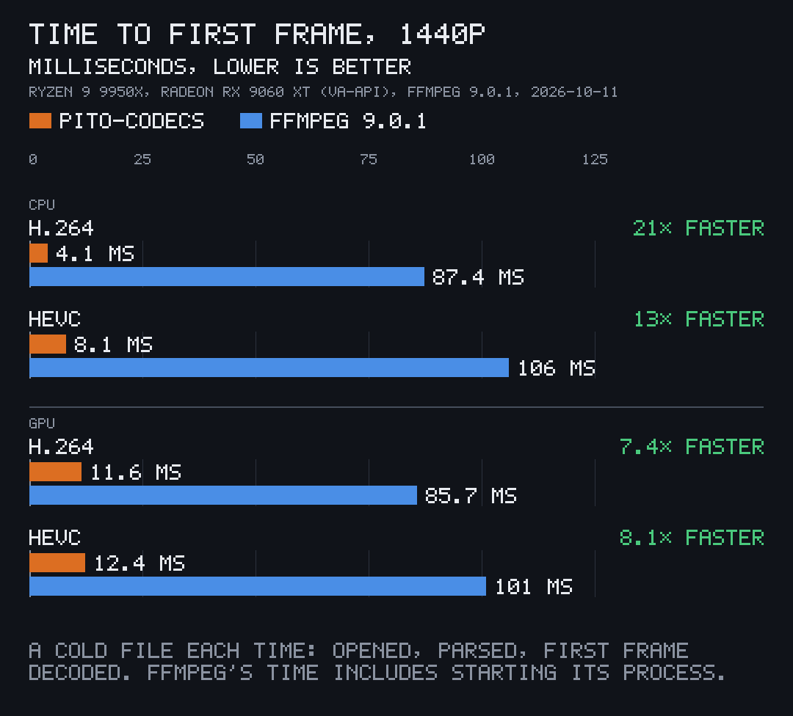

A seek decodes from the keyframe before the target, and the pictures on the way that nothing refers to (non-reference B-frames) are skipped, on the card and on the processor, with every shown frame unchanged. Opening a file 10.5 s in and showing that frame takes 30 to 40 ms on the card and 34 to 63 ms on the processor, 1.1× to 1.6× sooner than 1.4.2:

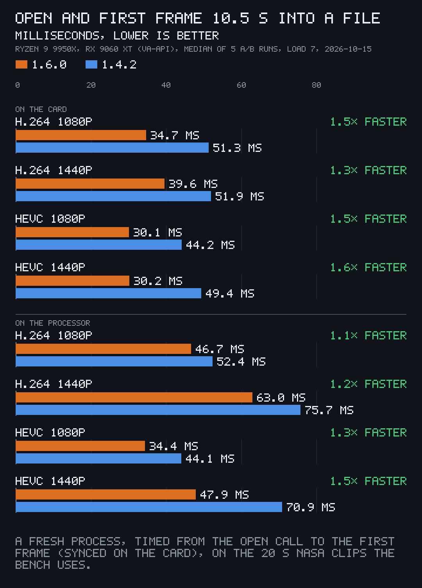

An MKV or WebM file opens for video from its headers and Cues alone, then seeks through the Cues, so its size doesn't matter, and every caller that opens the same file at once shares one read. On a gigabit network share, a 4.4 GB, 71-minute 720p H.264 MKV showed its first frame in 110 ms at the start and 193 ms at 35 minutes, reading 6.3 MB each time, where reading every cluster first took 32.8 s on a 3.9 GB file on the same share.

### Filmstrips

`frames_at` takes stills at any times, from the keyframe at or before each one, and reads only what it needs; in MKV and WebM it seeks through the file's Cues, so a still late in a long recording costs the same as one at the start. `frames_at_seek` with `Seek::Exact` decodes on to the exact frame. This strip of 12 stills was taken by `frames_at` and written by our own GIF encoder (`examples/readme_shots.rs`), in 63 to 272 ms for the stills across runs on a shared machine and 27 ms for the GIF:

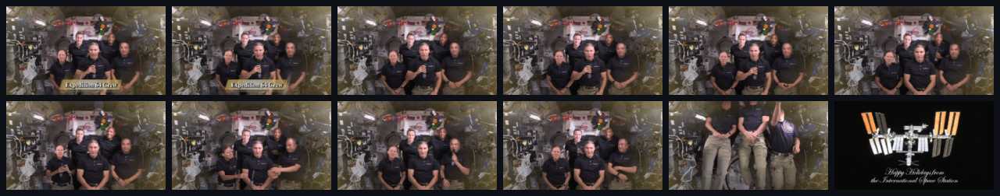

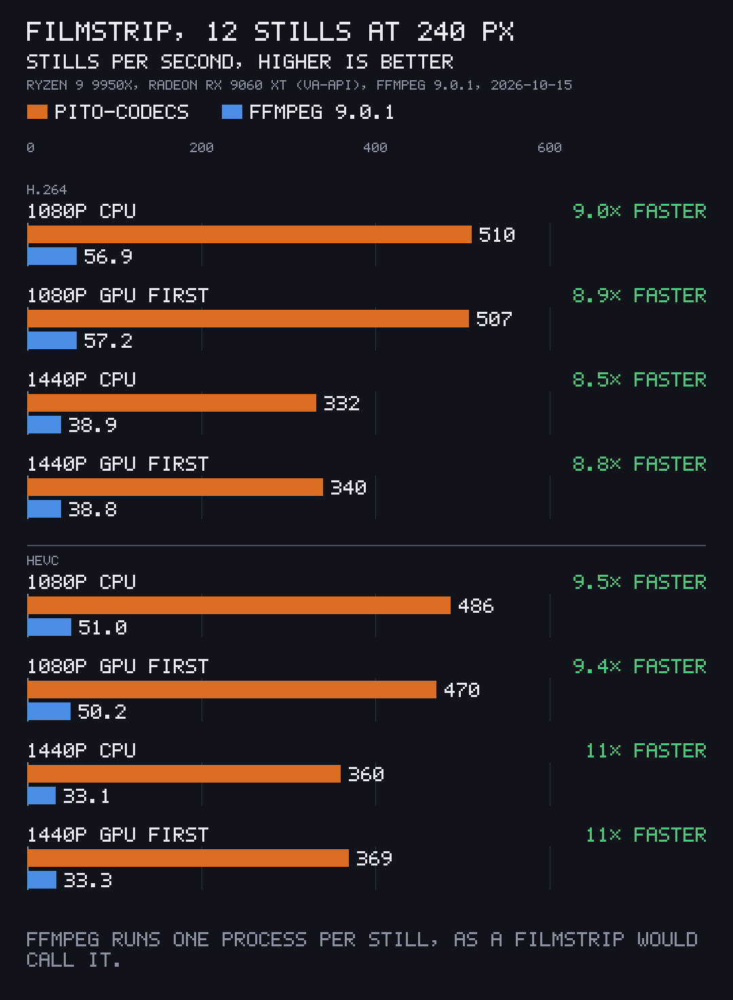

An app that asks for stills again and again keeps a `Stills` handle: `Stills::open(path, height, prefs)` opens the file once, and `stills.frames(times, seek, |index, still| …)` reuses its decoders across calls and hands each still over as soon as it is decoded, in any order; `stills.each(times, seek)` waits for them all and returns one result per time, in order. Exact stills skip the pictures before each target that nothing refers to and that can't be the one shown. On a 120 s 1080p H.264 file with B-frames and 8 s GOPs, a 24-still filmstrip at 90 px takes 10.8 ms instead of 22.5 ms through separate calls (16.8 ms instead of 30.3 ms from MKV), 27 rail stills at 160 px 12.1 ms instead of 18.0 ms, and 6 exact stills at 480 px 309 ms instead of 520 ms, every still byte-identical to 1.6.1's. A handle runs and keeps up to 16 decoders; `stills.keep(n)` caps both, and `stills.trim()` drops the kept ones when the app goes idle. With three handles open on that file (filmstrip, rail and exact stills), keeping 4 decoders each brings the process's peak from 916 MB to 442 MB, and 27 rail stills then take 22 ms instead of 11 ms; keeping 2, 188 MB and 36 ms.

`pcod stills` does the same from the command line: N evenly spaced stills (`--count`) or stills at given times (`--at 90,1:30,1:02:03.5`), at a height (`--height`, 360 by default), written as PNGs into a folder (`--out`) and/or as one contact sheet of rows by columns with padding (`--sheet`, `--rows`, `--cols`, `--pad`); `--seek keyframe` takes the keyframe at or before each time instead of the exact frame, and `--json` lists each still's time, size and path. The PNGs come from our own encoder, a port of fdeflate's PNG-tuned deflate. A 24-still sheet of a 10-minute 1080p H.264 file took 0.54 to 0.62 s on the GPU route, where ffmpeg's `fps,scale,tile` filter chain took 5.2 to 6.6 s, run in turn three times each at load 30 on a 32-thread machine; on a 60 s file, 0.41 to 0.45 s against 0.82 to 0.85 s.

`pcod filmstrip` draws tiles of a video on a cadence into one image: a tile every `--every` (`2s`, `500ms`, `1.5` or `0:01`) or `--count` tiles spread over the video or a `--from`/`--to` window, each `--height` pixels high (90 by default), in one row or wrapped into a grid (`--wrap`, `--max-width`), with `--gap`, `--background` and each tile's time under it with `--timecodes`, as PNG, JPEG or WebP by the output's extension. Each tile is the keyframe at or before its time by default, and its label shows the time it really shows; `--seek exact` takes the exact frame. A 60-tile strip of exact frames, one every 10 seconds of a 10-minute H.264 file, took 0.19 s at 1080p and 0.97 s at 4K on the GPU route (0.23 s and 1.16 s on the CPU), where ffmpeg's `fps=1/10,scale=-1:90,tile=60x1` took 13.1 s and 23.9 s: 21× to 67× faster. With the default keyframe seek the same strips take 0.08 s and 0.26 s. The first frame of those files as a full-size PNG took 48 ms at 1080p and 171 ms at 4K on the CPU, against ffmpeg's 85 ms and 245 ms.

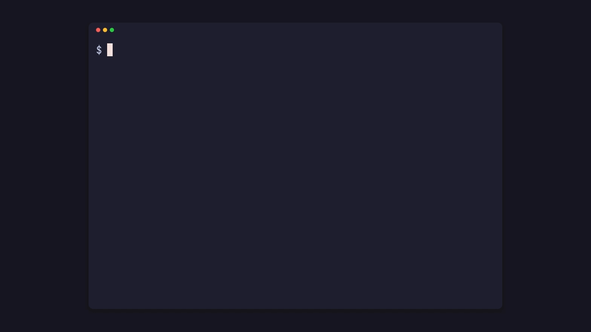

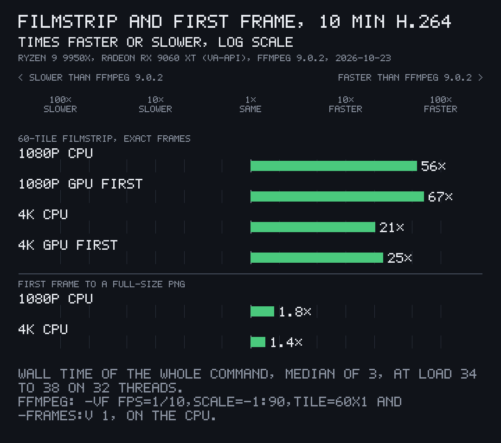

### Decode on the CPU and the GPU

H.264 (Baseline, Main and High), H.265 (Main and Main 10, tiles and WPP) and VP9 (profiles 0 to 3) decode bit-exact with ffmpeg on the CPU, with threads across rows and frames and SIMD picked at run time. On the GPU, VA-API on Linux and VideoToolbox on macOS decode the same streams bit-exact. A frame read back from VA-API is copied only once no later picture refers to it, so the copies don't hold up decoding.

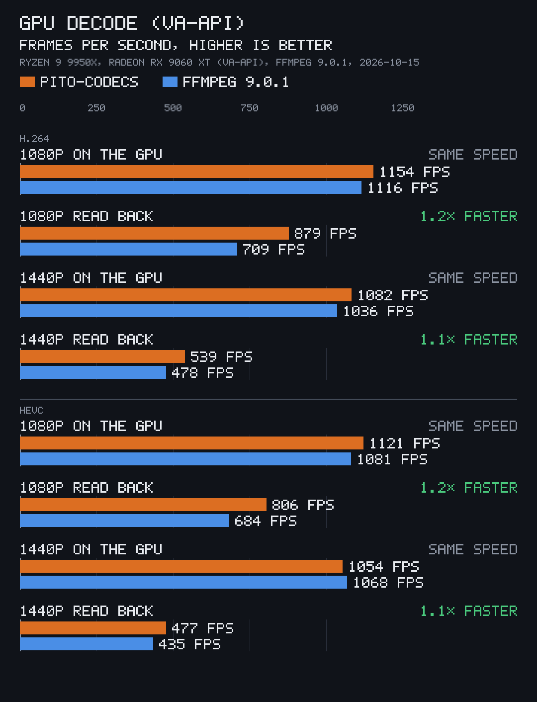

On the CPU, ffmpeg's hand-written assembly still decodes H.264 1.3× to 1.5× faster; HEVC is level to 1.1× faster on one thread:

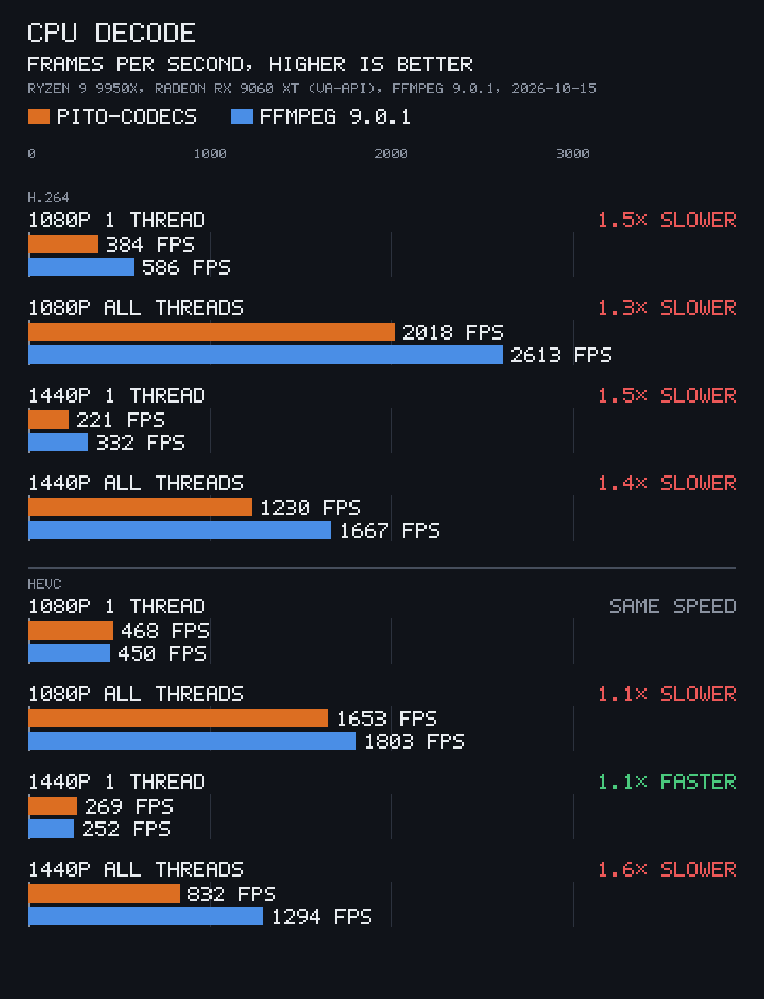

### AV1

AV1 in MP4, MKV and WebM probes, shows its first frame, takes stills and decodes on the card through VA-API, with frames that can stay on the card, and on the processor everywhere else. Our header parser is a port of ChromiumOS's cros-codecs, and the processor decoder is a port of rav1d, the Rust translation of dav1d. Every frame of the test streams (8 and 10-bit, tiles, film grain, hidden frames shown later, size switches) is bit-exact with dav1d on both routes. On a 20 s 1080p30 AV1 file from SVT-AV1, run in turn three times each at load 27 to 29:

| Job | Card (VA-API) | Processor (ours) | ffmpeg with dav1d |
| --- | --- | --- | --- |
| First frame, 240 px | 26 to 71 ms | 38 to 46 ms | 89 to 119 ms |
| 12 stills, 240 px | 26 to 36 ms | 30 to 32 ms | 73 to 85 ms |
| Decode 300 frames at 1080p | 460 to 514 fps | 174 to 214 fps | 365 to 675 fps |

The processor decoder has no SIMD, so a whole decode runs at about a quarter of dav1d's assembly; the first frame and stills come first anyway, because the file opens without a separate process.

### Encode and transcode on the GPU

H.264 and H.265 encode through VA-API, VideoToolbox and NVENC, and a transcode keeps every frame on the GPU from decode to encode. Our VA-API encodes run 1.1× to 1.2× faster than ffmpeg's at the same settings.

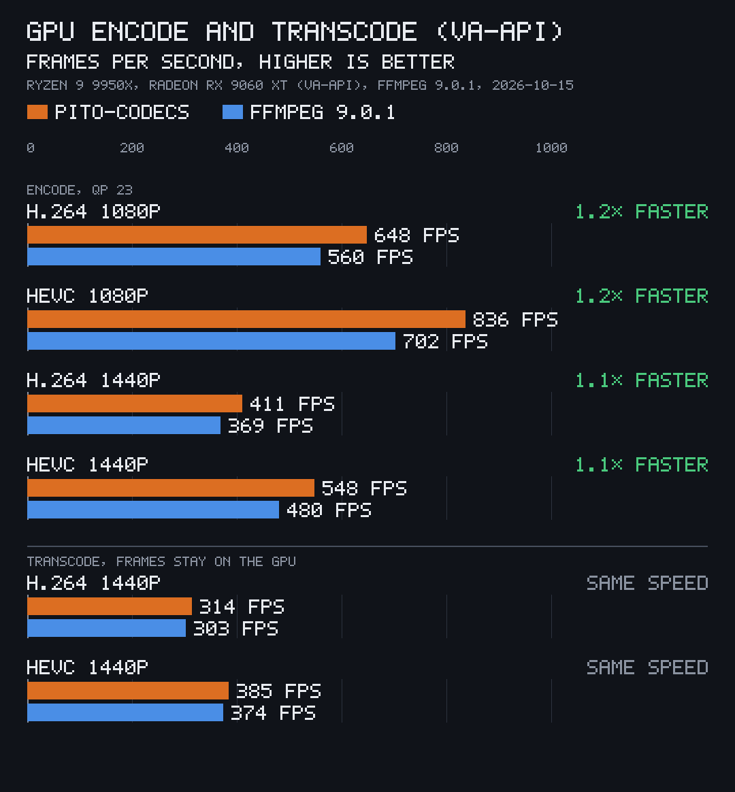

The CPU H.264 encoder (CABAC, B-frames, CRF, QP, CBR and VBR) has no hand-written SIMD, and libx264 is 1.2× to 3.1× faster. H.265 encodes on the GPU only, and without a GPU HEVC encoder the front falls back to H.264 and says why.

At matched SSIM on a 30 s 1080p talking-head clip, measured against ffmpeg 9.0.1 with x264 and libvpx, our CPU H.264 and VP9 encoders make files 1.5 to 1.9 times larger than x264 and libvpx (3.8 to 4.8 times on screen content) and run 1.3 to 1.4 times slower than x264 medium and slow. The GPU encoders are the default route. Contributions are welcome.

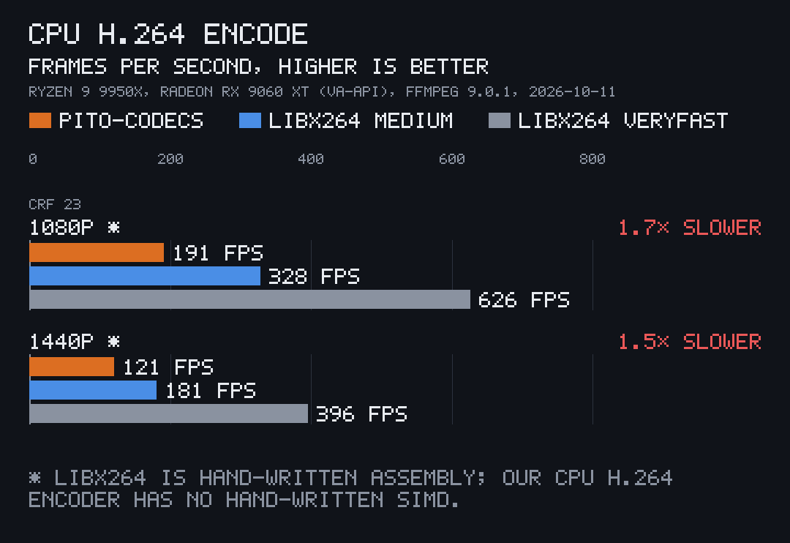

### Smart-cut export

`export` and `export_with_audio` write an edit from pieces of one or more files. They copy the middle of each piece as it is and re-encode only the frames around each cut, so the result is frame-accurate and 1.7× to 2.0× faster than ffmpeg re-encoding every frame. ffmpeg's stream copy is faster still, but it encodes nothing and can only cut on keyframes.

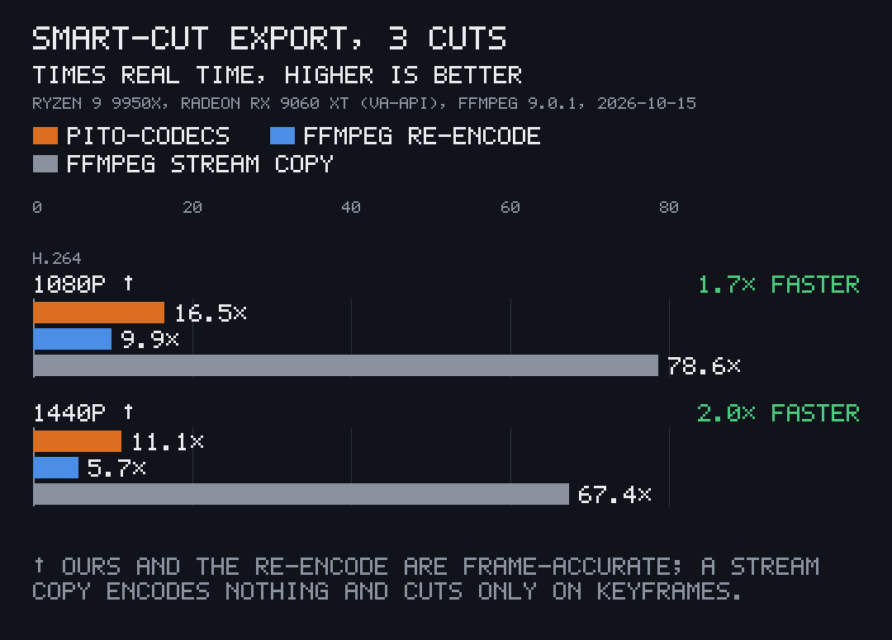

Before each cut, the frames from the keyframe to the cut point are decoded but not shown, and the pictures among them that nothing refers to are skipped. With many short cuts, where almost every frame is re-encoded, 40 cuts of about 1 s each from a 1080p30 file with B-frames take 4.6 s on the card for an H.264 source and 4.8 s for HEVC, 1.3× and 1.4× faster than 1.4.2, and 1.1× to 1.2× faster on the processor, with every frame identical. Against ffmpeg re-encoding the same 40 pieces in the same run, that is 1.2× (H.264 source) and 1.8× (HEVC) faster on the card, and 1.5× and 1.1× on the processor.

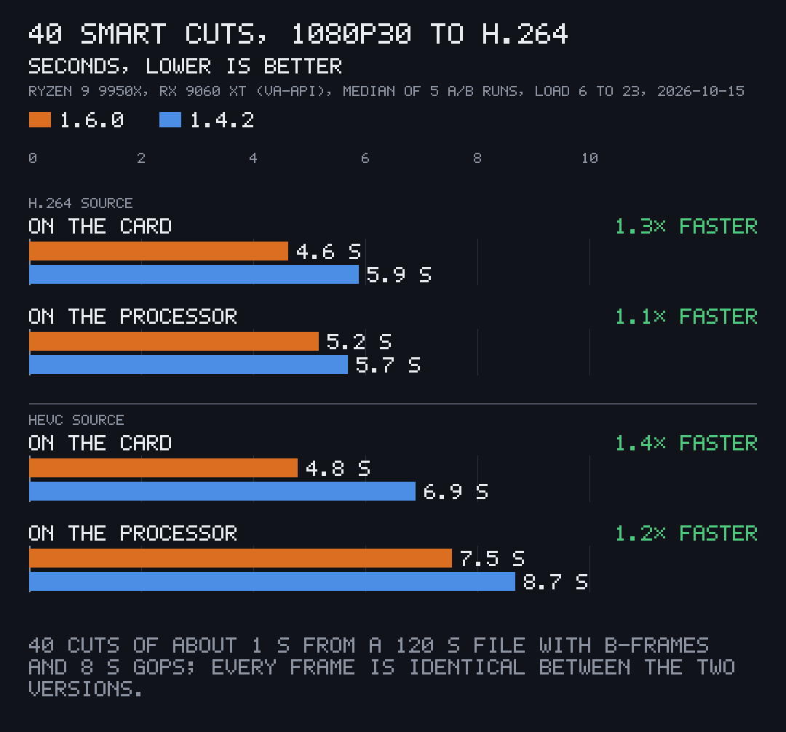

When two cut edges fall in one GOP, as a piece's end and the next piece's start do when silences are cut out, they share one decode from the keyframe instead of each decoding it. On the card that takes 40 cuts of an H.264 source from 6.2 s to 4.3 s and an edit of 46 pieces with the gaps between them removed from 9.6 s to 6.4 s, every frame identical; an HEVC source, whose pre-roll was already cheap, cuts at the same speed as before.

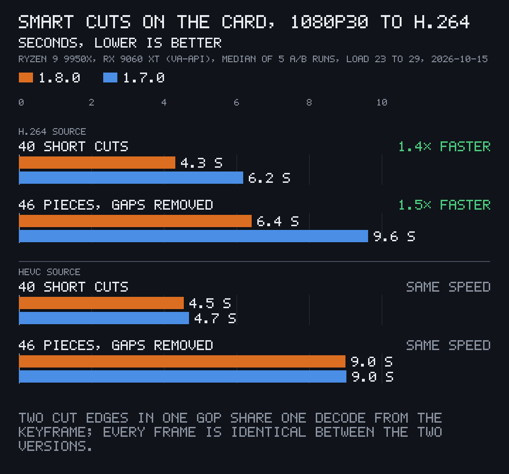

VP9 sources cut the same way into MP4 (`vp09`): packets are copied as they are, superframes included, and only the frames before each piece's first keyframe are encoded, in parallel keyframe-led chunks. A 3-piece, frame-accurate cut of a 720p60 VP9 file ran at 1365 to 3285 frames a second with the machine at load 20, against about 500 for re-encoding it to H.264 on the GPU.

### Overlays composed on the card

An export can draw an RGBA overlay on every frame: a watermark, or karaoke captions that change at every word. On VA-API with Mesa's driver, the overlay is blended on the card by a VA-API video-processing pass straight into the encoder's input surface. Frames go from decode to encode without a copy to system memory, and the overlay is uploaded only when it changes, and only its painted area. The graphics queue is never used. Other GPU encoders draw the overlay on the CPU.

H.264, H.265 and VP9 sources export this way. A 120 s, 1920x804 VP9 file (24 fps, libvpx profile 0) exported to H.264 with a corner mark in 6.4 s on the card against 24.1 s decoded, blended and encoded on the CPU; with captions, 6.4 s against 33.9 s.

This frame's caption and corner mark were drawn as one RGBA layer and blended by `media::Blender` in 1.8 ms at 1280x720 (`examples/readme_shots.rs`):

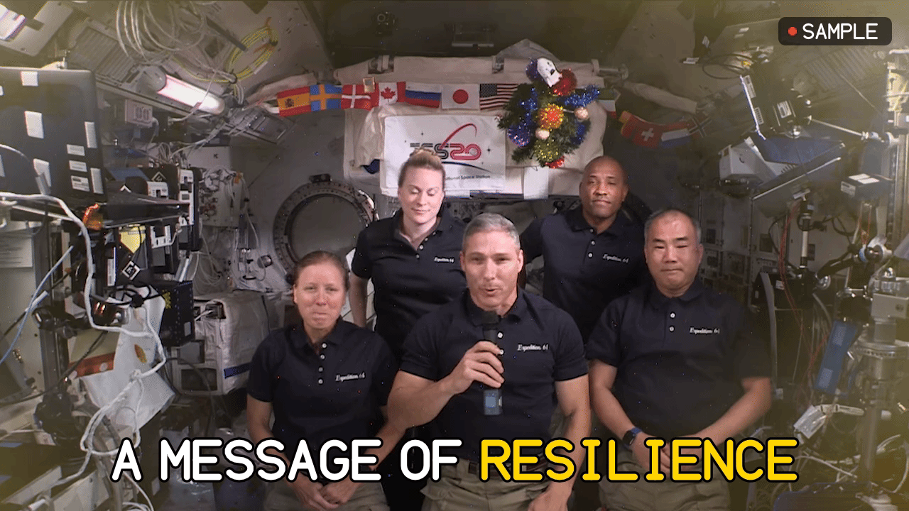

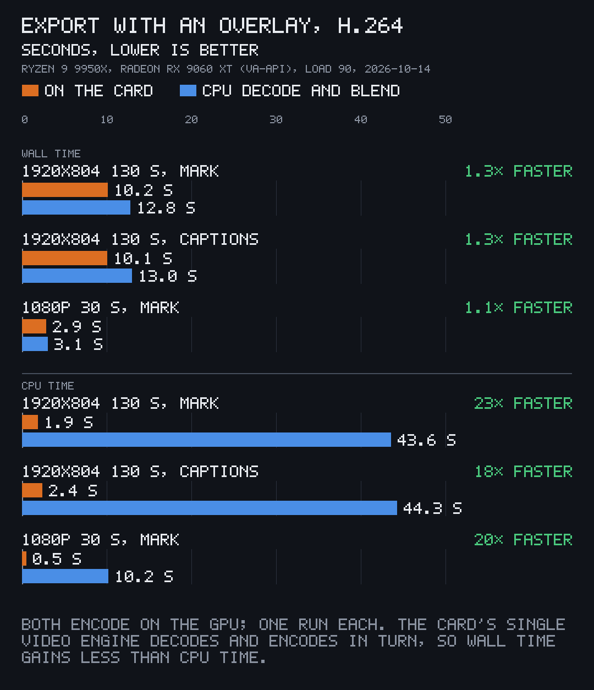

On the CPU, a caption change costs what its painted area costs: building the layer takes 0.5 to 0.9 ms at 1080p and 1.7 to 2.3 ms at 4K, 8 and 10-bit, bit-exact with the earlier full-frame pass that took 22.5 to 135 ms.

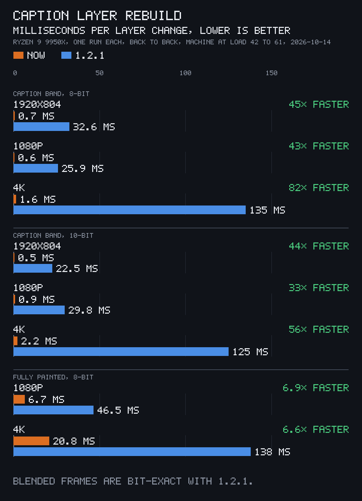

### Audio

AAC-LC decode and encode, Opus decode and encode (CELT; SILK and hybrid speech encode are experimental), and AC-3, E-AC-3, MP3, MP2, MP1, FLAC, ALAC and PCM decode, from MP4, MOV, M4A, MKV and WebM; a bare `.flac` file reads and seeks to the exact sample with `flac::Reader`. `audio_pcm_range` returns any time range as PCM, sample-exact; `audio_stream` hands it over in one-second blocks; `audio_mix_stream` mixes several tracks with a gain each. Loudness (EBU R128) and a true-peak limiter come with it.

An MKV seek lands on each audio track by that track's own timestamps, even when a remux stored the track minutes away from the video it plays with: on a 2-hour recording whose second PCM track sat 400 to 770 s behind the video in the file, 2 s of that track at 2000 s and 4000 s now read in 4 to 6 ms, where 1.6.1 took 0.4 to 1.9 s.

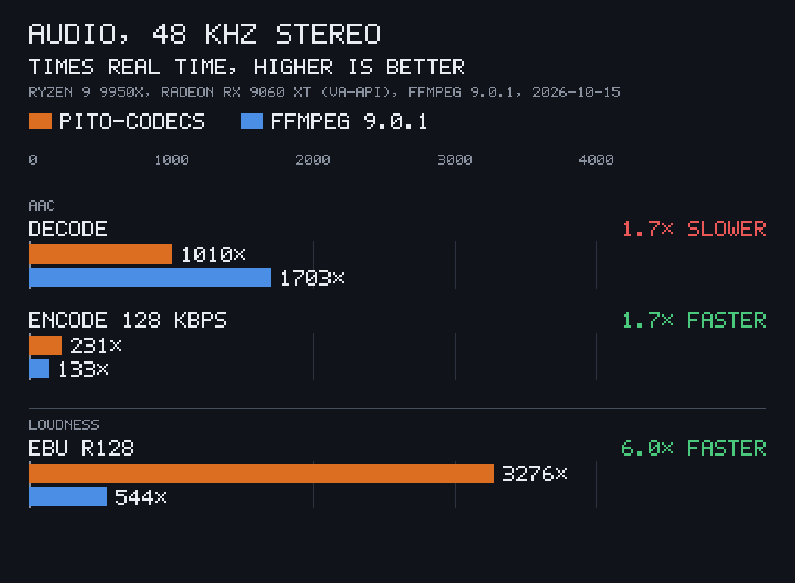

- **AC-3 and E-AC-3** (ported from oxideav-ac3): 10 minutes of 5.1 at 448 kbps decode in 0.56 to 0.59 s on one core against ffmpeg's 0.55 to 0.87 s, and to stereo through `audio_pcm_range` in 0.28 to 0.33 s against ffmpeg's 0.68 to 1.01 s. Within 2e-5 of ffmpeg's float decoder.
- **MP3** (ported from minimp3): 10 minutes of stereo at 192 kbps decode in 0.32 s on one thread against ffmpeg's 0.30 to 0.38 s, and in 0.16 s from MKV through `audio_pcm_range` against ffmpeg's 0.31 s. Within 4.4e-6 of ffmpeg's mp3float. A bare `.mp3` file decodes gapless with `mp3::decode_file`, which skips ID3 and APE tags and trims the encoder delay and padding its LAME or Xing header gives, sample for sample as ffmpeg does.

### GIF and WebP

GIF (Oklab palettes, ordered or Floyd-Steinberg dither, frame differencing) and WebP (lossless and lossy, alpha, animation, bit-exact with libwebp on decode) read and write stills and animations. These 30 frames at 480x270 were encoded by our GIF encoder in 29 ms (1.9 MB, ordered dither, 128 colours); the same frames as lossy animated WebP take 42 ms and 406 KB ([animated.webp](docs/images/animated.webp)):

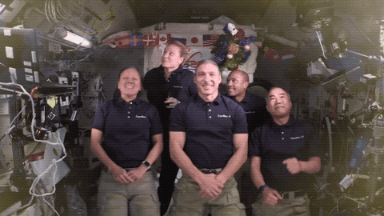

### Scale and filters

Scaling (bilinear, bicubic, Lanczos) runs 1.6× to 2.1× faster than ffmpeg's swscale on all threads. Colour (BT.601, 709 and 2020), rotate, flip, crop, pad, frame-rate change, overlays, resampling, downmix, gain, loudness and a limiter sit between decode and encode.

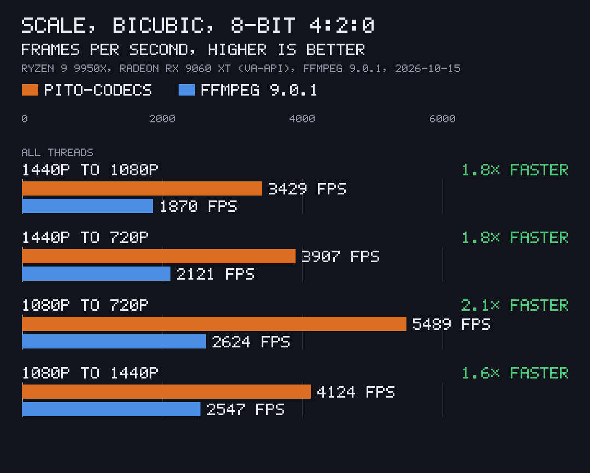

## Formats

| Part | Decode | Encode |
| --- | --- | --- |
| H.264 | CPU: Baseline, Main and High, progressive 8-bit 4:2:0, CAVLC and CABAC, bit-exact with ffmpeg. GPU: VA-API and VideoToolbox for the same profiles, bit-exact; Media Foundation. | CPU: Baseline, Main and High with CABAC and B-frames; CRF, QP, CBR and VBR. GPU: VA-API High; VideoToolbox Main and High; NVENC. |
| H.265 | CPU: Main and Main 10, tiles and WPP, bit-exact with ffmpeg. GPU: VA-API and VideoToolbox, Main and Main 10, bit-exact; Media Foundation. | GPU only: VA-API Main; VideoToolbox Main and Main 10; NVENC. Without a GPU HEVC encoder it falls back to H.264 and says why. |
| VP9 | CPU: profiles 0 to 3 (8, 10 and 12-bit; 4:2:0, 4:2:2 and 4:4:4), tiles, bit-exact with ffmpeg and libvpx, through `vp9::Decoder`; the media front (`decode_video`, stills, exports) takes 8 and 10-bit 4:2:0 and refuses the other profiles by name. GPU: VA-API for 8 and 10-bit 4:2:0, bit-exact. | CPU: profile 0, with motion search, trellis, rate control, AQ and tile threads; ffmpeg and libvpx decode it bit-exact to our reconstruction. |
| AV1 | CPU: profiles 0 and 1 (8 and 10-bit, 4:2:0 and 4:4:4), tiles, film grain and frame threading, a port of rav1d, bit-exact with dav1d; no SIMD, so about a quarter of dav1d's speed. GPU: VA-API profile 0, 8 and 10-bit, film grain, hidden and shown-again frames and size switches at keyframes, bit-exact with dav1d; VideoToolbox and Media Foundation. | — |
| AAC | AAC-LC, mono to 7.1. | AAC-LC, CBR and VBR. |
| AC-3 and E-AC-3 | Mono to 5.1 at 32, 44.1 and 48 kHz with coupling and rematrixing, within 2e-5 of ffmpeg's float decoder. Spectral extension, AHT and 7.1 through E-AC-3 dependent substreams are built but untested, since ffmpeg's encoder makes none of them; enhanced coupling and the reduced sample rates are refused. | — |
| Opus | SILK, CELT, hybrid and multistream; the RFC 8251 conformance vectors decode to the reference's final range on every packet. | CELT, VBR and CBR, 6 to 510 kbps. **Experimental:** SILK and hybrid speech decode clean in libopus but sound worse than libopus at low rates. |
| MP3, MP2, MP1 | MPEG-1, 2 and 2.5 audio, layers I, II and III, mono and stereo, CBR and VBR, within about 1e-6 of ffmpeg's mp3float. | — |
| FLAC | 4 to 31-bit, mono to 8 channels, fixed and variable block sizes, every subframe and stereo mode, escape-coded partitions; bit-exact with libFLAC. In .flac, MKV and MP4; a file cut short plays up to the cut. 32-bit streams are refused, and the probe marks them not native as "32-bit FLAC". `examples/flac.rs` prints its decode speed, with `--against-flac` beside the reference decoder. | — |
| ALAC | 16, 20, 24 and 32-bit, mono to 8 channels, in MP4, MOV, M4A and MKV, ported from Apple's reference decoder; 16 and 24-bit streams from ffmpeg's encoder decode bit-exact to its input, and 20 and 32-bit are checked on hand-built streams. Surround comes out in WAVE order, as from the AAC decoder. | — |
| MP4 and MOV | Tracks, sample tables, rotation, edit lists, fragmented files. | MP4 or MOV, faststart or fragmented; remux of a time range without re-encoding. |
| MKV and WebM | Tracks, lacing, Cues, seeking; VP9 with alpha. | H.264, HEVC, VP9, Opus and AAC; VP9 with alpha as libvpx writes it (a second VP9 stream in BlockAdditional, AlphaMode on the track); WebM's codec rules enforced; remux. |
| GIF | GIF87a and 89a, interlace, disposal, transparency, loops. | Oklab palettes, ordered, Floyd-Steinberg or Sierra-2-4A dither; each frame stores only the rectangle that changed beyond a noise tolerance, and a slow change over a fifth of the frame redraws it whole. |
| WebP | Lossless VP8L and lossy VP8, alpha, animation; bit-exact with libwebp. | Lossless VP8L and lossy VP8, alpha, animation. |
| PNG | Grey, grey and alpha, RGB, RGBA and palette with tRNS, 1 to 16-bit, Adam7, all five filters; to 8-bit RGBA, equal to ffmpeg's decode. | — |
| JPEG | — | Baseline JFIF, 4:2:0, quality 1 to 100 on the IJG tables; a port of jpeg-encoder with libjpeg-turbo's AVX2 colour conversion and DCT, chosen at run time. At 1080p its files are within 0.5% of libjpeg-turbo's cjpeg in size at the same PSNR, in 8 to 12 ms. |
| WAV | PCM 8, 16, 24 and 32-bit, float 32 and 64-bit, any rate and channel count. | — |

Not covered: DTS, Vorbis, AV1 encode, ProRes, DNxHD, MPEG-2 and VP8 video, and subtitle tracks.

## GPUs and systems

The front tries the GPU first and our own CPU code second, for every decode and every encode, and every fallback says why in a plain reason an app can show. What each GPU route has been run on:

| Route | System | Decode | Encode | Tested on |
| --- | --- | --- | --- | --- |
| VA-API, AMD (Mesa radeonsi) | Linux | H.264, H.265, VP9, AV1 | H.264, H.265; overlays composed on the card | AMD Radeon RX 9060 XT (RDNA 4), before every release |
| VA-API, Intel (iHD) | Linux | H.264, H.265, VP9, AV1 | H.264, H.265 | Built, untested on Intel hardware |
| VideoToolbox | macOS | H.264, H.265, AV1 | H.264, H.265 | An Apple Silicon Mac before every release: the test suite runs there, decodes compared with ffmpeg where it is installed, encodes decoded back; AV1 (Apple M3 and later) built, untested |
| NVENC | Linux, Windows | — | H.264, H.265 | Built and unit-tested, untested on NVIDIA hardware |
| Media Foundation | Windows | H.264, H.265, AV1 | — | Built and unit-tested, untested on GPU hardware |

The NVIDIA paths are built and unit-tested but untested on NVIDIA hardware here; contributions from people with NVIDIA cards are welcome.

The CPU codecs target Linux x86-64 and arm64, Windows x86-64 and macOS on Apple Silicon, with AVX2 kernels on x86-64 and NEON or portable paths on arm64. Every merge is checked for all four (format, lints and a full type-check) and runs the whole test suite on Linux x86-64; every release also runs the suite on an Apple Silicon Mac and the GPU suite on the AMD card above, and builds the Linux x86-64, Windows x86-64 and macOS binaries. No hosted CI runs this repository.

## Small and simple

- **Two direct dependencies** for the library on Linux, rayon and libloading, 8 crates in all; clap only for pcod, behind the `cli` feature. No C or C++ is linked, and libva is loaded at run time, so a binary starts on a machine without it.
- **pcod is 5.7 MB** (v1.3.0, Linux x86-64, release build, stripped).
- **About 134,000 lines of Rust** under `src/`, one package with a feature per part.
- **Graceful on bad input:** every parser and decoder has a cargo-fuzz target in `fuzz/`, and malformed files return errors instead of panicking.

## Use the library

Decode an MP4's H.264 track on the CPU:

```rust
use pito_codecs::{h264, mp4};

let file = mp4::Reader::open("clip.mp4")?;
let video = file.video().expect("a video track");
let track = &file.tracks[video];
let mut decoder = h264::Decoder::with_extradata(&track.extradata().unwrap_or_default())?;
for index in 0..track.samples.len() {
    for frame in decoder.decode(&file.packet(video, index)?)? {
        println!("{} {}x{}", frame.pts, frame.width, frame.height);
    }
}
let rest = decoder.flush()?;
```

Encode frames to H.264 at CRF 18:

```rust
use pito_codecs::h264::{Encoder, EncoderConfig};
use pito_codecs::media::Rate;

let mut encoder = Encoder::new(EncoderConfig { width: 1920, height: 1080, fps: (60, 1), rate: Rate::Crf(18), ..Default::default() })?;
let avcc = encoder.avcc();
let packets = encoder.encode(&frame)?;
```

Decode on the GPU when one is there:

```rust
use pito_codecs::gpu::{self, HwDecoder};
use pito_codecs::media::Codec;

println!("{:?}", gpu::available());
let mut decoder = HwDecoder::new(Codec::Hevc, &hvcc)?;
let frames = decoder.decode(&packet)?;
```

Or let the front pick the route:

```rust
use pito_codecs::media::{
    Prefs, Seek, audio_pcm_range, audio_stream, first_frame, frames_at, frames_at_seek, probe,
};

let prefs = Prefs::default();
let info = probe("clip.mp4".as_ref(), &prefs)?;
let still = first_frame("clip.mp4".as_ref(), 240, &prefs)?;
let strip = frames_at("recording.mkv".as_ref(), &[60.0, 5400.0], 120, &prefs)?;
let exact = frames_at_seek("recording.mkv".as_ref(), &[61.5], 240, Seek::Exact, &prefs)?;
let slice = audio_pcm_range("recording.mkv".as_ref(), 0, 30.0, 60.0, 48_000, 2, &prefs)?;
for block in audio_stream("recording.mkv".as_ref(), 0, 0.0, 16_000, 1, &prefs)? {
    let block = block?;
}
```

`frames_at` shows the keyframe at or before each time, which is what a filmstrip wants; `frames_at_seek` with `Seek::Exact` decodes on to the frame shown at that time, and decodes a GOP once for all the times inside it. A range past the end of the track returns only the samples it has, so a buffer shorter than asked means the track ended. `audio_stream` hands the audio over in one-second blocks as it decodes and ends at the track's end. In MKV and WebM, stills and audio seek through the file's Cues, so a still or a slice late in a long recording reads only the clusters around it.

Export an edit with audio you mixed yourself: the callback gets each piece's index and its exact sample count and returns that many 48 kHz stereo samples, which our AAC encoder turns into one track as long as the video to the sample:

```rust
let done = export_with_audio("edit.mp4".as_ref(), &pieces, ExportOptions::default(), |piece, samples| mixer.render(piece, samples), |_| true)?;
```

Export frames you made yourself, at your own size and rate: the frame callback gets each frame's index and the last frame back to reuse and returns `None` to end, and the audio callback gets the frames so far and the samples that cover them:

```rust
let canvas = Canvas { width: 1080, height: 1920, fps: (60, 1), frames: Some(600) };
let done = export_frames("vertical.mp4".as_ref(), canvas, ExportOptions::default(), |n, spent| comp.render(n, spent), |frames, samples| mixer.render(frames, samples), |_| true)?;
```

Draw one RGBA overlay on many frames without copying it each time: a `Blender` keeps the overlay it was given, and an `Arc` of the same image draws straight away.

```rust
let mut blender = Blender::new();
blender.draw(&mut frame, &watermark);
```

`pcod` (`src/bin/pcod.rs`) is a small command line over the library. `pcod <input> <output>` converts a file, an animated GIF or a folder of PNG frames to MP4, MOV, MKV, WebM, GIF or WebP and `pcod join` stitches clips (see Convert above); the GIF at the top shows `pcod decode clip.mp4 --route gpu`, or from a checkout `cargo run --release --bin pcod -- decode clip.mp4 --route gpu`. `pcod frames <dir> <out.mp4> --fps 60 --audio sound.wav` encodes a folder of PNG frames in name order and a WAV into an H.264 (or HEVC) and AAC MP4, BT.709 and faststart, decoding the PNGs on every core ahead of the encoder. It refuses an existing output unless `--force`, and `--crf 0` is near-lossless, not bit-exact (57 to 68 dB luma PSNR measured): pcod's encoders have no lossless mode. `pcod stills clip.mp4 --sheet sheet.png` writes a contact sheet; see Filmstrips. `pcod synth <out> --size WxH --fps R --duration D --audio sine:440,sine:880,silence` writes a test video with no ffmpeg: seven colour bars with a moving box, the frame number in digits and as 24 white-or-black bits, and one stereo track per `--audio` entry (a -18 dBFS sine or silence) at `--rate` (48000 by default); mp4, mov and mkv carry H.264 and AAC, webm VP9 and Opus, and the same command on the same build and machine writes the same bytes. `pcod loudness <file> --json` also gives `max_volume`, the sample peak in dBFS to 0.1 dB, from -91.0 for silence up to 0.0, as ffmpeg's volumedetect reports it, and the `duration` in seconds (the whole file's). It is behind the `cli` feature, on by default, so a library user with `default-features = false` never builds clap.


## How it was measured

**Against ffmpeg** (the overview and the first-frame, filmstrip, decode, encode, export, scale and audio charts): one run of `examples/bench.rs` on 2026-10-15 at commit `743f2d0`, each job back to back with the system ffmpeg on the same file, on an AMD Ryzen 9 9950X (16 cores) and an AMD Radeon RX 9060 XT on Mesa 26.2.2 radeonsi through VA-API, Linux, ffmpeg 9.0.1. The input is 20 s of NASA's public-domain "A Message of Resilience from the International Space Station" (720p60), scaled to 1080p and 1440p and encoded with libx264 at CRF 20 and libx265 at CRF 23; the audio is NASA's public-domain solstice interview. The command is `target/release/examples/bench --runs 1`, run through the test machine's GPU queue, in its bench class, built first with `cargo build --release --example bench`, and it writes `tmp/bench/results.json`. The card was the bench's alone and the load average was 1.4 at the start and 7.1 at the end, on 32 threads.

**Today's additions** (the overlay charts, the VP9 cut, AC-3 and MP3) were each measured once, back to back against the baseline named, on the same machine while it was busy with other work, at the load given beside each; their absolute numbers are floors, and the ratios are same-run comparisons.

- Overlay layer rebuild: `cargo run --release --example media_speed -- captions`, `filter::Overlay::new` on a caption band about 10% painted, against v1.2.1's implementation, load 42 to 61.
- Export with an overlay: `media_speed <file> xport`, a 130 s 1920x804 and a 30 s 1080p H.264 export with a corner mark or captions, GPU-resident against CPU decode and blend with GPU encode, load about 90.
- Export of a VP9 source with an overlay: `media_speed <file> xport gpu gpu mark` against `xport cpu cpu mark` (and `captions`), 2880 frames of 1920x804 at 24 fps, 5 Mb/s, load 17 to 22.
- MKV open on a network share: `media_speed <file> open 0 2100`, one run on a cold file over gigabit SMB, against the earlier full-cluster read timed on a 3.9 GB file on the same share.
- VP9 smart cut: `media_speed <file> spans vp9 …`, a 3600-frame 720p60 VP9 file at 3 Mb/s, 3 pieces, 2967 frames, keyframes every 120 or 240 frames, load about 20.
- pcod filmstrip and first frame: a 10-minute 1080p30 and a 10-minute 2160p30 H.264 file (testsrc2, libx264 veryfast, CRF 20, a keyframe every 2 s), release pcod against ffmpeg 9.0.2 on the CPU, wall time of the whole command, three runs each, medians, at load 34 to 38 on 32 threads through the test machine's GPU queue in its bench class. Filmstrip: `pcod filmstrip <file> strip.png --every 10 --height 90 --seek exact` against `ffmpeg -i <file> -vf fps=1/10,scale=-1:90,tile=60x1 -frames:v 1 strip.png`. First frame: `pcod stills <file> --from 0 --to 0.034 --height <the file's height> --route cpu --out <dir>` against `ffmpeg -i <file> -frames:v 1 000000.png`.
- AC-3: 10 minutes of 5.1 at 448 kbps against `ffmpeg -threads 1 -benchmark` and `ffmpeg -ac 2`, load 20 to 50. MP3: 10 minutes of stereo at 192 kbps against ffmpeg's mp3float, load 33.

**1.6.0 against 1.4.2** (the seek and 40-cut charts): both tags built in release, then run alternately, A B A B, five runs each after one warm-up, each in a fresh process, and each side's median taken; the card's runs went through the test machine's GPU queue, in its bench class. The seek rows time `decode_video` (processor) and `decode_video_gpu` (card, the frame synced) from the call to the first frame at 10.5 s into the bench's 20 s 1080p and 1440p clips, load about 7. The cut rows are `ROUTE=gpu media_speed <file> cuts 40` and `ROUTE=cpu …` on a 120 s 1080p30 testsrc2 file encoded by libx264 veryfast (B-pyramid, keyint 250) and by libx265 ultrafast (4 B-frames), exported to H.264; load about 6 on the card's rows and 19 to 23 on the processor's, which load the machine themselves. The comparison with ffmpeg ran right after, three rounds of 1.6.0 on the card, 1.6.0 on the processor and ffmpeg cutting the same 40 pieces (`ffmpeg -ss <from> -i <file> -t <length> -c:v libx264 -preset veryfast -crf 18 -c:a aac -b:a 192k` per piece, then the concat demuxer with `-c copy`), medians taken, at load 9 to 16 with other builds running, so its ratios are directional. Exports with the mark, which this release doesn't touch, measured the same in both: 2.46 s at 1080p and 7.6 s at 4K on the card.

**1.7.0 against 1.6.1** (the `Stills` and MKV audio numbers): run alternately, A B A B, five runs each after one warm-up, medians taken, the card's runs through the test machine's GPU queue, in its bench class. Stills: each run opens the 120 s 1080p30 file (libx264 veryfast, B-pyramid, keyint 250, as MP4 and remuxed to MKV) and asks five rounds of a 24-still filmstrip at 90 px (1.6.1: two `frames_at_seek` calls of 3 and 21, as an app does today; 1.7.0: one call on a kept handle), 27 keyframe stills at 160 px and 6 exact stills at 480 px; the median of rounds two to five, at load 12 to 16. On MKV the first of 24 stills arrives in 11 ms against 8 ms for a separate 3-still call, since 16 decoders start at once. MKV audio: `audio_pcm_range` for 2 s at 2000 s and 4000 s of each PCM track of a private 2-hour OBS recording remuxed with its audio twice, read in place, at load 13 to 16.

**1.8.0 against 1.7.0** (the shared smart-cut chart): both tags built in release and run alternately, A B A B, five runs each after one warm-up, medians taken, through the test machine's GPU queue, in its bench class, at load 23 to 29 with other jobs running. The cuts are `ROUTE=gpu media_speed <file> cuts 40` and `ROUTE=gpu media_speed <file> spans h264 …` with 46 pieces of 1 to 3 s and gaps of 0.25 to 0.85 s between them (91 s kept), on the same 120 s 1080p30 files as above. The processor's rows ran at load 36 to 67 and spread more within each side than between them, so they are not shown.

The charts are drawn by [pito-compare](https://github.com/gmrdad82/pito-compare) from the data files in [docs/charts](docs/charts): `pcmp docs/charts/<name>.json`.

<details>
<summary>Every row of the 2026-10-15 run</summary>

| Job | pito-codecs | ffmpeg | pito-codecs is |
| --- | --- | --- | --- |
| H.264 1080p decode, CPU, 1 thread | 384 fps | 586 fps | 1.5× slower |
| H.264 1080p decode, CPU, all threads | 2018 fps | 2613 fps | 1.3× slower |
| HEVC 1080p decode, CPU, 1 thread | 468 fps | 450 fps | about the same |
| HEVC 1080p decode, CPU, all threads | 1653 fps | 1803 fps | 1.1× slower |
| H.264 1440p decode, CPU, 1 thread | 221 fps | 332 fps | 1.5× slower |
| H.264 1440p decode, CPU, all threads | 1230 fps | 1667 fps | 1.4× slower |
| HEVC 1440p decode, CPU, 1 thread | 269 fps | 252 fps | 1.1× faster |
| HEVC 1440p decode, CPU, all threads | 832 fps | 1294 fps | 1.6× slower |
| H.264 1080p decode, VA-API, frames stay on the GPU | 1154 fps | 1116 fps | about the same |
| H.264 1080p decode, VA-API, frames read back | 879 fps | 709 fps | 1.2× faster |
| HEVC 1080p decode, VA-API, frames stay on the GPU | 1121 fps | 1081 fps | about the same |
| HEVC 1080p decode, VA-API, frames read back | 806 fps | 684 fps | 1.2× faster |
| H.264 1440p decode, VA-API, frames stay on the GPU | 1082 fps | 1036 fps | about the same |
| H.264 1440p decode, VA-API, frames read back | 539 fps | 478 fps | 1.1× faster |
| HEVC 1440p decode, VA-API, frames stay on the GPU | 1054 fps | 1068 fps | about the same |
| HEVC 1440p decode, VA-API, frames read back | 477 fps | 435 fps | 1.1× faster |
| H.264 1080p encode, CPU, CRF 23, against libx264 medium * | 212 fps | 354 fps | 1.7× slower |
| H.264 1080p encode, CPU, CRF 23, against libx264 veryfast * | 215 fps | 664 fps | 3.1× slower |
| H.264 1080p encode, VA-API, QP 23 | 648 fps | 560 fps | 1.2× faster |
| HEVC 1080p encode, VA-API, QP 23 | 836 fps | 702 fps | 1.2× faster |
| H.264 1440p encode, CPU, CRF 23, against libx264 medium * | 137 fps | 167 fps | 1.2× slower |
| H.264 1440p encode, CPU, CRF 23, against libx264 veryfast * | 139 fps | 292 fps | 2.1× slower |
| H.264 1440p encode, VA-API, QP 23 | 411 fps | 369 fps | 1.1× faster |
| HEVC 1440p encode, VA-API, QP 23 | 548 fps | 480 fps | 1.1× faster |
| H.264 1440p GPU transcode, frames stay on the GPU | 314 fps | 303 fps | about the same |
| HEVC 1440p GPU transcode, frames stay on the GPU | 385 fps | 374 fps | about the same |
| H.264 1440p time to first frame, CPU (ffmpeg includes starting its process) | 4.2 ms | 85.2 ms | 20.2× faster |
| H.264 1440p time to first frame, GPU (ffmpeg includes starting its process) | 3.5 ms | 87.4 ms | 24.9× faster |
| HEVC 1440p time to first frame, CPU (ffmpeg includes starting its process) | 7.4 ms | 88.9 ms | 12.1× faster |
| HEVC 1440p time to first frame, GPU (ffmpeg includes starting its process) | 3.2 ms | 88.9 ms | 28.2× faster |
| H.264 1080p filmstrip, 12 stills at 240 px, CPU | 510 stills/s | 57 stills/s | 9.0× faster |
| H.264 1080p filmstrip, 12 stills at 240 px, GPU first | 507 stills/s | 57 stills/s | 8.9× faster |
| H.264 1440p filmstrip, 12 stills at 240 px, CPU | 332 stills/s | 39 stills/s | 8.5× faster |
| H.264 1440p filmstrip, 12 stills at 240 px, GPU first | 340 stills/s | 39 stills/s | 8.7× faster |
| HEVC 1080p filmstrip, 12 stills at 240 px, CPU | 486 stills/s | 51 stills/s | 9.5× faster |
| HEVC 1080p filmstrip, 12 stills at 240 px, GPU first | 470 stills/s | 50 stills/s | 9.4× faster |
| HEVC 1440p filmstrip, 12 stills at 240 px, CPU | 360 stills/s | 33 stills/s | 10.9× faster |
| HEVC 1440p filmstrip, 12 stills at 240 px, GPU first | 369 stills/s | 33 stills/s | 11.1× faster |
| Smart-cut export 1080p, 3 cuts, against ffmpeg re-encoding every frame (both frame-accurate) † | 16.5× real time | 9.9× real time | 1.7× faster |
| Smart-cut export 1080p, 3 cuts, against ffmpeg's stream copy (keyframe cuts only, not frame-accurate) † | 16.5× real time | 78.6× real time | 4.8× slower |
| Smart-cut export 1440p, 3 cuts, against ffmpeg re-encoding every frame (both frame-accurate) † | 11.1× real time | 5.7× real time | 2.0× faster |
| Smart-cut export 1440p, 3 cuts, against ffmpeg's stream copy (keyframe cuts only, not frame-accurate) † | 11.1× real time | 67.4× real time | 6.1× slower |
| Scale 1440p to 1080p, bicubic | 3429 fps | 1870 fps | 1.8× faster |
| Scale 1440p to 720p, bicubic | 3907 fps | 2121 fps | 1.8× faster |
| Scale 1080p to 720p, bicubic | 5489 fps | 2624 fps | 2.1× faster |
| Scale 1080p to 1440p, bicubic | 4124 fps | 2547 fps | 1.6× faster |
| AAC decode, 48 kHz stereo | 1010× real time | 1703× real time | 1.7× slower |
| AAC encode, 128 kbps stereo | 231× real time | 133× real time | 1.7× faster |
| EBU R128 loudness, 48 kHz stereo | 3276× real time | 544× real time | 6.0× faster |

\* libx264 is hand-written assembly; our CPU H.264 encoder has no hand-written SIMD. † Our export copies the middle of each piece and re-encodes only around each cut, so it is frame-accurate; a stream copy encodes nothing and cuts only on keyframes.

</details>

## Part of PITO MD

pito-codecs is the media layer of [PITO MD](https://pitomd.com): Splicer, PITO MD's desk for cutting talking-head videos from their transcripts, opens, plays, cuts and exports through it. Its open siblings:

- [prec](https://github.com/gmrdad82/prec) records the terminal clip at the top of this page, and pcod, this repository's command line, turns it into the GIF.
- [pito-compare](https://github.com/gmrdad82/pito-compare) draws every chart on this page.
- [pfx](https://github.com/gmrdad82/pfx) and Manfred render and build scenes; [pito-tui](https://github.com/gmrdad82/pito-tui) is the shell of PITO MD's terminal apps.

## Build and test

```
cargo build --release
cargo test --release
```

The tests use the system ffmpeg as an oracle when it is installed and skip those checks when it is not, and the GPU tests skip cleanly without a device. `bin/gate` runs rustfmt, clippy with warnings as errors (also with only the audio features, and for Windows, macOS and Linux on ARM when their std is installed), the tests through cargo-nextest, then a release build (`--fast` skips the build). `bin/docs-bundle vX.Y.Z [out dir]` builds `docs-vX.Y.Z.tar.gz`, the documentation each Release carries: the guides in `docs/site`, a command reference made from pcod's own help, the API reference from `cargo doc` and the changelog.

Every change is checked on the maintainer's machines before it merges: formatting, clippy with warnings as errors, the tests with ffmpeg as the oracle, and the doc tests. Every release runs the full suite and builds pcod for Linux x86-64, Windows x86-64 and macOS on Apple Silicon there too, along with the VA-API tests and the benchmarks on an AMD card; the GitHub Release carries those binaries and their checksums. Media Foundation, NVENC and VideoToolbox are built for their systems; Media Foundation and NVENC have not run on their hardware here.

## Contributing

Issues are welcome at [github.com/gmrdad82/pito-codecs/issues](https://github.com/gmrdad82/pito-codecs/issues). Useful ones include a file that decodes wrong or slowly (with a small sample, where you can share one), a route that falls back when it shouldn't, or a format you need. Pull requests aren't taken. Please read the [code of conduct](CODE_OF_CONDUCT.md) first, and report security issues privately, as [SECURITY.md](SECURITY.md) describes.

## Credits

Parts are adapted from [FilmCraft](https://github.com/storytold/filmcraft) (MIT OR Apache-2.0, taken under MIT) and from libwebp (BSD-3-Clause), oxideav-ac3 (MIT), jpeg-encoder (MIT, with the Independent JPEG Group's and libjpeg-turbo's notices), minimp3 (CC0), libFLAC (BSD-3-Clause), Claxon (Apache-2.0) and Apple's ALAC (Apache-2.0). The VA-API and NVENC declarations follow the MIT-licensed libva and NVIDIA headers. Permissive projects such as libvpx and libopus (BSD-3-Clause) may be ported with their notices; the GPL and LGPL ones (FFmpeg, x264, x265, libde265) are never copied, and ffmpeg serves only as the test oracle and the benchmark reference. The ITU-T H.264 and H.265 Recommendations, ATSC A/52, the VP9 specification, RFC 6716, RFC 6386, the GIF89a specification and the ISO MP4 and AAC standards are the sources. Origins are listed in [INSPIRATION.md](INSPIRATION.md) and their notices in [NOTICE](NOTICE). The demo and benchmark clips are public-domain NASA footage from PITO MD's fixture sets.

## Licence


The code is MIT licensed ([LICENSE](LICENSE)), © Catalin Ilinca. The PITO MD name and its logos are © Catalin Ilinca, all rights reserved, and are not covered by the MIT licence ([TRADEMARKS.md](TRADEMARKS.md)).
